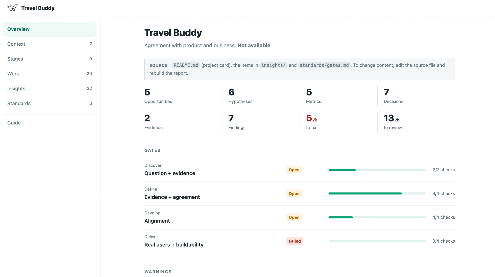
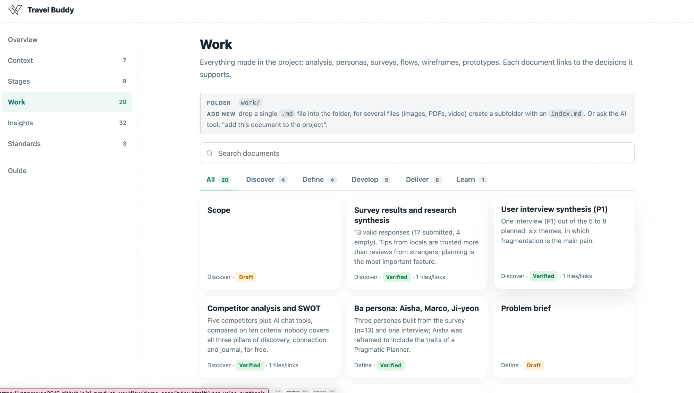
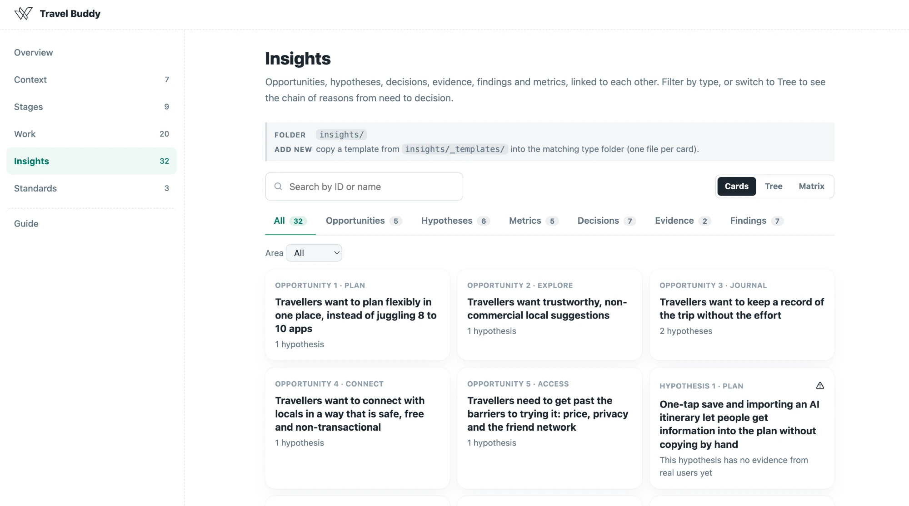
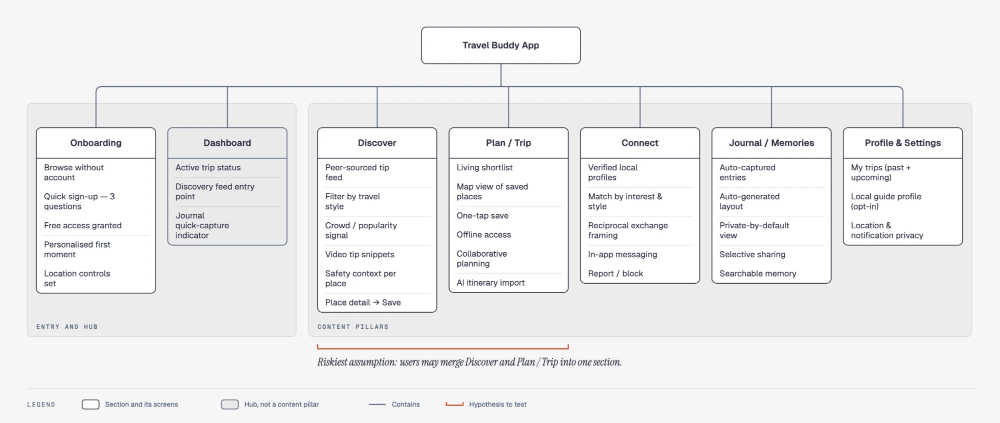
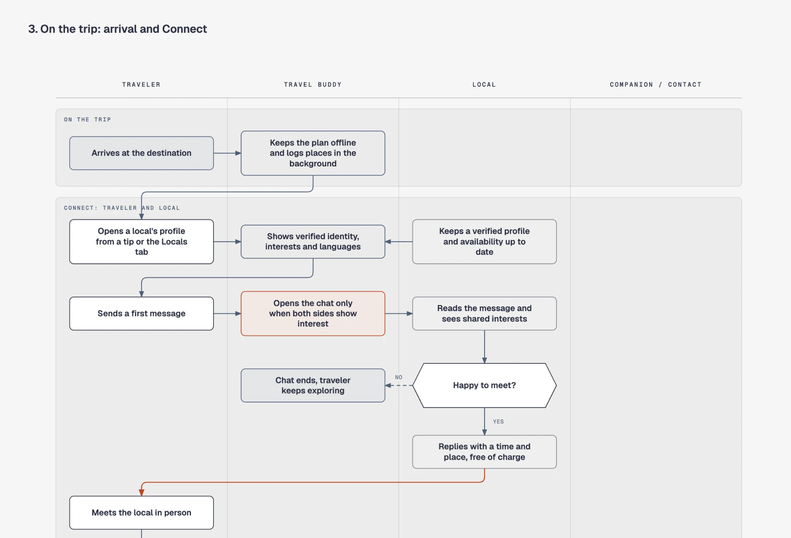
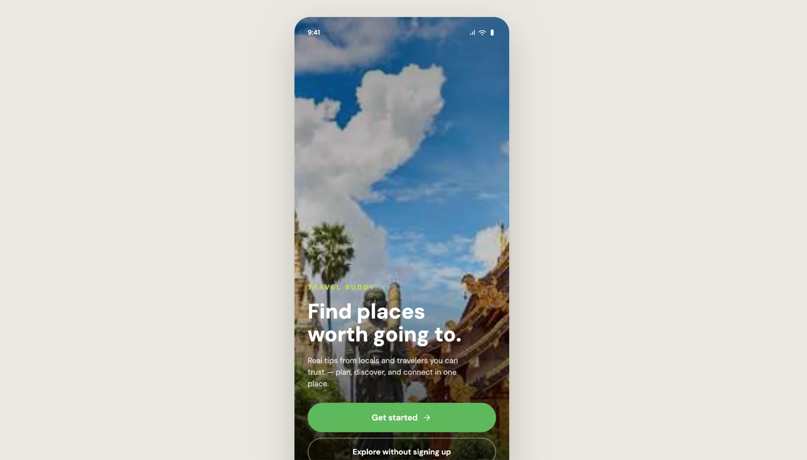

# Outcome Examples

Sáu ảnh từ Travel Buddy, dự án thật của giảng viên, để xem output của chương trình trông như thế nào khi đã nằm trong Knowledge Hub. Mỗi ảnh là một loại output mà học viên sẽ tạo ra ở các tuần khác nhau.

## Knowledge Hub: Overview

Tổng quan của hub: số lượng item theo loại (opportunity, hypothesis, metric, decision, evidence, finding), tình trạng bốn gate theo từng stage, và những cảnh báo cần xử lý. Đây là trang đầu tiên người khác nhìn vào.

## Knowledge Hub: Work

Mọi tài liệu làm ra trong dự án (competitor analysis, persona, survey, synthesis, flow), lọc theo stage. Mỗi tài liệu có trạng thái Draft hoặc Verified để người đọc biết điều gì đã được kiểm tra.

## Knowledge Hub: Insights

Opportunity, hypothesis, decision, evidence, finding và metric liên kết với nhau, xem theo Cards, Tree hoặc Matrix. Hypothesis chưa có evidence từ người dùng thật được đánh dấu cảnh báo.

## Information architecture

Cấu trúc của ứng dụng: hai mục entry và hub, năm content pillar. Giả định rủi ro nhất được đánh dấu để đem đi kiểm chứng: người dùng có thể gộp Discover và Plan / Trip thành một mục.

## User flow

Swimlane cho một hành trình trên chuyến đi, với các lane Traveler, Travel Buddy, Local và Companion. Điểm nhấn là quyết định chỉ mở chat khi cả hai bên cùng quan tâm.

## Prototype

Màn hình chào của prototype, dựng bằng AI coding tool từ design system notes và rules file của dự án.
