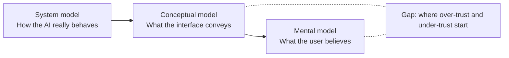
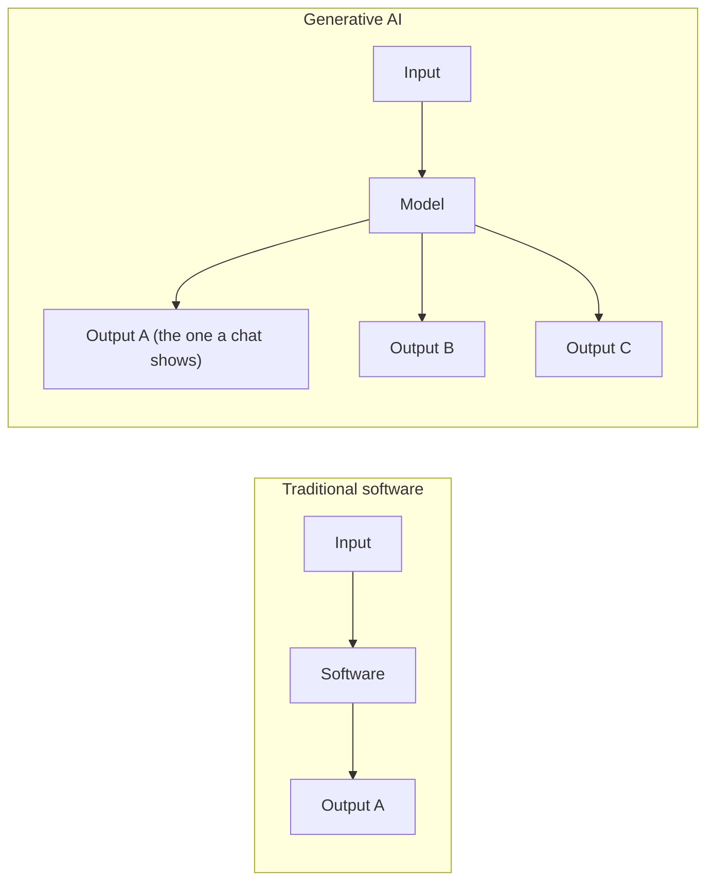
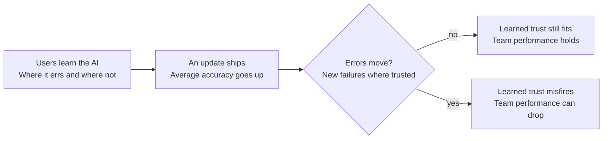
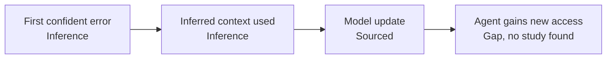
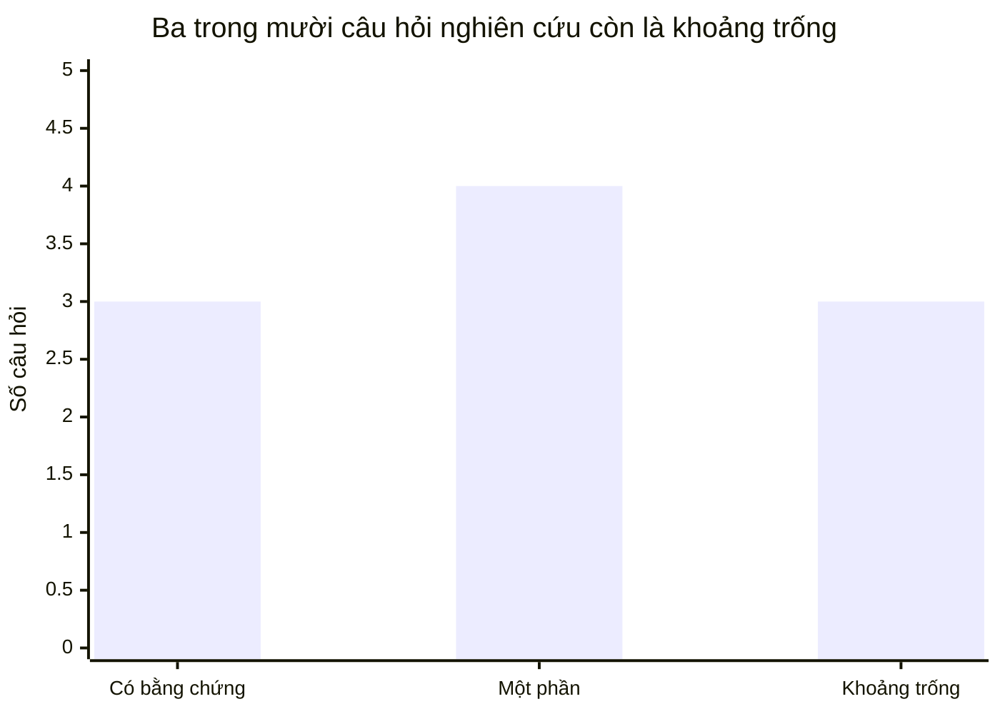

# AI Mental Model: Desk Research

18/10/2026

> **Nguồn duy nhất của report này là file `.md`.** Bản HTML có sơ đồ vẽ sẵn (2026-10-18) đã chuyển vào `_archive/ai-mental-model-desk-research-2026-10-18-html.html`; sơ đồ ở đây dùng mermaid. Phần Harness và agent mở rộng ở `ai-mental-model-harness.md`; định nghĩa kỹ thuật về agent, harness, MCP, skills ở `agentic-ai-concepts.md`.

## 1. AI mental model là gì

AI mental model là biểu diễn nhận thức mà một người dùng để giải thích và dự đoán một hệ thống AI: nó làm được gì, vì sao ra kết quả đó, khi nào nó sai. Định nghĩa gốc của "mental model" không riêng cho AI: đó là cấu trúc người ta dùng để hiểu và dự đoán hệ thống phức tạp ([Vanderlyn et al., 2024](https://arxiv.org/html/2408.14154v1), dẫn Johnson-Laird, Norman).

**Gốc khái niệm.** Craik (1943) cho rằng tâm trí xây các mô hình thu nhỏ của thực tại để suy luận. Norman đưa vào thiết kế và tách ba thứ hay bị lẫn: system model (hệ thống thật vận hành ra sao), conceptual model của designer (cách designer muốn người dùng hiểu, thể hiện qua giao diện), và mental model của người dùng (điều họ thực sự tin). Nguồn thứ cấp: [Ballpark, Research Glossary](https://ballparkhq.com/research-glossary/mental-model).

Hai mô hình đầu là phía hệ thống và designer; mô hình thứ ba nằm trong đầu người dùng, và vấn đề của AI xuất hiện ở khoảng cách giữa hai mô hình sau.

**Ba đặc tính quan trọng với AI.**

- Hình thành nhanh và vô thức, khó sửa sau khi đã định hình. Nghiên cứu về agent AI khuyên làm giàu mô hình sẵn có thay vì ép thay thế ([IJCAI 2021, mental models of AI agents](https://www.ijcai.org/proceedings/2021/0648.pdf)).
- Không quan sát trực tiếp được; chỉ suy ra qua elicitation. Một workshop năm nay còn cảnh báo khái niệm này bị dùng lỏng và lẫn với folk theories, sensemaking, nên kết quả nghiên cứu khó so sánh với nhau ([MM/AI workshop](https://www.emergentmind.com/papers/2609.17206)).
- Nhiều mô hình mâu thuẫn cùng tồn tại. Với dialog agent, người dùng giữ nhiều mô hình xung đột, và độ đúng của mô hình ảnh hưởng trực tiếp đến thành công của tương tác ([Vanderlyn et al., 2024](https://arxiv.org/abs/2408.14154)).

**Các mô hình thường gặp, và lệch ở đâu.**

- AI như công cụ tìm kiếm: kỳ vọng một đáp án đúng duy nhất. Người dùng tìm kiếm hội thoại có mô hình quá trừu tượng, không đủ để giải thích từng lượt trả lời ([arXiv 2506.03807](https://arxiv.org/html/2506.03807v1)).
- AI như người: gán trạng thái tâm thần và độ tin cậy giống người. Giọng nói và đại từ "tôi" làm tăng mức anthropomorphism và điểm đánh giá độ chính xác trong thí nghiệm n=2.165 ([Cohn et al., CHI 2024](https://research.google/pubs/believing-anthropomorphism-examining-the-role-of-anthropomorphic-cues-on-user-trust-in-large-language-models/)). Điểm tinh tế: gán "ý thức" cho LLM không dự đoán việc nghe theo lời khuyên của nó, còn gán "trí thông minh" thì có ([Colombatto et al., 2025](https://researchonline.lse.ac.uk/id/eprint/128172)).
- AI như hệ thống xác định: người dùng sao chép mô hình từ cách hỏi trợ giúp phần mềm truyền thống rồi gặp lỗi và quá tin (overtrust) ([arXiv 2402.08030](https://arxiv.org/pdf/2402.08030)).

## 2. Khác gì so với phần mềm truyền thống

Khác biệt lõi: người dùng mang vào AI những mô hình hình thành từ công nghệ xác định và từ làm việc nhóm với người, trong khi AI sinh văn bản mang tính xác suất, khó nhìn thấu và đổi nhanh ([Saßmannshausen & Wagener, Triadic Framework](https://www.qeios.com/read/GAG6KD/pdf), bản preprint đang được peer review). Amershi et al. (Microsoft) cũng nêu lý do tương tự: nhiều thành phần AI có hành vi xác suất theo từng nhiệm vụ và bối cảnh, nên có thể hành động trái mục tiêu và kỳ vọng của người dùng ([CHI 2019](https://www.microsoft.com/en-us/research/publication/guidelines-for-human-ai-interaction/)).

Phần mềm truyền thống trả một kết quả cho mỗi input; AI có thể trả nhiều kết quả hợp lý, mà giao diện chat thường chỉ hiển thị một.

| Chiều so sánh | Phần mềm truyền thống | Hệ thống AI | Bằng chứng |
| --- | --- | --- | --- |
| Hành vi với cùng input | Ổn định, tái hiện được | Có thể đổi giữa các lần; một câu trả lời đơn lẻ trông chắc chắn khiến người dùng ngộ nhận có một đáp án đúng duy nhất | [Stochasticity study, 2025](https://arxiv.org/html/2503.16114v1) |
| Ranh giới năng lực | Rõ, do danh sách tính năng | Không đều ("jagged"): giỏi và dở xen kẽ, khó đoán trước | [Triadic Framework](https://www.qeios.com/read/GAG6KD/pdf) |
| Quan hệ nhân quả | Hành động A dẫn tới kết quả B, học được qua thử | Kết quả phụ thuộc cách diễn đạt và ngữ cảnh; mô hình người dùng thường quá trừu tượng để giải thích từng lượt | [arXiv 2506.03807](https://arxiv.org/html/2506.03807v1) |
| Thay đổi theo thời gian | Đổi theo bản phát hành | Cập nhật đổi hành vi; bản cập nhật tăng độ chính xác vẫn có thể làm giảm hiệu quả nhóm người-AI vì phá mô hình người dùng đã học | [Bansal et al., AAAI 2019](https://ojs.aaai.org/index.php/AAAI/article/view/4087) |
| Hướng ảnh hưởng | Người dùng điều khiển, hệ thống phản hồi | Hai chiều: phản hồi của người dùng chỉnh mô hình, mô hình chỉnh lại cách người dùng tương tác | [PAIR Guidebook, Mental Models](https://pair.withgoogle.com/chapter/People%20+%20AI%20Guidebook%20-%20Mental%20Models.pdf) |
| Hệ quả khi mô hình sai | Hiểu nhầm giao diện, thao tác sai | Over-trust hoặc under-trust; trust calibration và anthropomorphism liên quan chặt | [Stochasticity study](https://arxiv.org/html/2503.16114v1), [Cohn et al., 2024](https://arxiv.org/abs/2405.06079) |

Lưu ý về độ chắc của bằng chứng: cột phần mềm truyền thống chủ yếu là khung lý thuyết (Norman), không phải kết quả thực nghiệm đối chứng trực tiếp. Chưa tìm được nghiên cứu nào so sánh cùng một nhóm người dùng trên phần mềm truyền thống và AI. Đây là khoảng trống, đưa vào phần research question.

## 3. Biết điều này giúp gì trong thiết kế

Nó biến "người dùng dùng AI sai" thành một vấn đề thiết kế có thể xử lý: khoảng cách giữa conceptual model mà giao diện truyền đạt và mental model người dùng hình thành. Nhận định của Triadic Framework là bài toán nên chuyển từ làm AI thông minh hơn sang làm mental model của người dùng phù hợp hơn ([Polemi, peer review](https://www.qeios.com/read/I4RTBX/pdf)). Bằng chứng thực nghiệm cho các thực hành dưới đây còn mỏng; mình ghi rõ chỗ nào là kết quả nghiên cứu, chỗ nào là khuyến nghị của guideline.

**Năm thực hành, kèm bằng chứng.**

1. Bắt đầu từ mô hình người dùng đã có. PAIR khuyên xác định mô hình họ mang từ giải pháp hiện tại, xây trên đó và dạy phần khác biệt; cảnh báo thông điệp quảng bá có thể tạo kỳ vọng quá cao ([PAIR, Mental Models](https://pair.withgoogle.com/chapter/People%20+%20AI%20Guidebook%20-%20Mental%20Models.pdf)). Đây là guideline, không phải kết quả đối chứng.
2. Nói rõ giới hạn và năng lực từ đầu, và sửa lỗi theo từng giai đoạn. Bộ 18 guideline của Microsoft chia theo bốn thời điểm: ban đầu, khi dùng thường xuyên, khi sai, và theo thời gian ([HAX](https://www.microsoft.com/research/project/guidelines-for-human-ai-interaction/)). Được kiểm chứng qua quy trình 4 bước trong bài CHI 2019.
3. Cho thấy tính biến thiên của output. Trong thí nghiệm trong-nhóm, người tham gia xem một câu trả lời hoặc mười câu (có và không có hỗ trợ nhận thức); giả thuyết của nhóm là chỉ thấy một câu trả lời trông chắc chắn dẫn đến mô hình sai và trust lệch ([Stochasticity study](https://arxiv.org/html/2503.16114v1)). Mình chưa đọc phần kết quả chi tiết, nên chưa nêu mức hiệu quả.
4. Minh bạch chỉ hiệu quả khi mô hình người dùng đã đủ đầy. Các vector minh bạch cải thiện khả năng diễn giải chỉ khi mô hình tinh thần đầy đủ hơn ([Understanding Mental Models of Generative Conversational Search](https://arxiv.org/html/2506.03807v1)). Hệ quả: chèn thêm giải thích không thay được việc xây mô hình nền.
5. Thích ứng hành vi theo mô hình người dùng và quản lý cập nhật. Điều chỉnh hành vi agent cho khớp mô hình người dùng, kể cả ngầm, cải thiện tính dễ dùng, hiệu quả hội thoại và thành công ([Vanderlyn et al.](https://aclanthology.org/2025.findings-naacl.56/)). Ở chiều ngược lại, cập nhật không tương thích với kinh nghiệm cũ có thể hại hiệu quả nhóm ([Bansal et al.](https://ojs.aaai.org/index.php/AAAI/article/view/4087)).

Bản cập nhật chỉ an toàn cho nhóm người-AI khi lỗi mới không rơi vào những chỗ người dùng đã học là tin được.

**Gắn vào 6 lớp và Double Diamond (đề xuất của mình, chưa kiểm chứng).**

| Lớp | Discover | Define | Develop | Deliver |
| --- | :---: | :---: | :---: | :---: |
| User interface | | | ● | ● |
| Context | ● | | ● | |
| Harness | | | ● | |
| Model | | ● | | |
| Governance | | ● | | ● |
| Emergence | ● | | | ● |

Dấu ● là lớp dẫn dắt ở giai đoạn đó, theo bản nháp workshop, không phải kết quả nghiên cứu. Discover và Define là problem space; Develop và Deliver là solution space.

| Lớp | Mental model cần chỉnh | Việc thiết kế |
| --- | --- | --- |
| Context | "Nó biết gì về mình?" | Hiển thị phần context người dùng đưa vào và phần hệ thống suy ra |
| User Interface | "Mình điều khiển được đến đâu?" | Cho thấy biến thiên và độ chắc chắn, chỗ can thiệp, chỗ giám sát |
| Governance | "Nó được và không được làm gì?" | Làm các giới hạn và lời từ chối đọc được |
| Model | "Nó giỏi và dở ở đâu?" | Truyền đạt ranh giới năng lực; kiểm tra tính tương thích khi đổi model |
| Harness | "Nó hành động bằng gì, thay mình làm gì?" | Hiển thị công cụ, kết nối, quyền của agent |
| Emergence | "Sao nó làm điều bất ngờ?" | Quan sát sau launch, cập nhật mô hình người dùng theo hành vi phát sinh |

Theo trục thời gian: Discover dùng để elicit mô hình hiện có, Define chốt conceptual model muốn truyền đạt, Develop dựng cách truyền đạt vào UI, Deliver kiểm tra độ lệch và theo dõi sau launch.

### Khi nào mental model bị vỡ

Mental model vỡ khi hành vi thật của AI mâu thuẫn với điều người dùng đã học hoặc mặc định. Hai nguyên nhân đầu trong bảng có nguồn; bốn nguyên nhân sau là suy luận của mình, chưa kiểm chứng.

Bốn khoảnh khắc cần canh trong sản phẩm; thứ tự chỉ để minh họa. Hai nguyên nhân còn lại, output biến thiên và ranh giới năng lực không đều, tác động xuyên suốt thay vì ở một thời điểm.

| Nguyên nhân | Vì sao vỡ | Mức bằng chứng | Việc thiết kế |
| --- | --- | --- | --- |
| Cập nhật model | Lỗi mới rơi vào chỗ người dùng đã học là tin được | Có nguồn: [Bansal et al.](https://ojs.aaai.org/index.php/AAAI/article/view/4087) | Ghi rõ điều gì đã đổi; kiểm tra tính tương thích trước khi đổi |
| Output biến thiên | Một câu trả lời đơn lẻ trông chắc chắn khiến người dùng ngộ nhận có một đáp án đúng duy nhất | Giả thuyết trong [Stochasticity study](https://arxiv.org/html/2503.16114v1); mình chưa đọc kết quả | Cho thấy nhiều phương án hoặc mức chắc chắn |
| Lỗi tự tin đầu tiên sau khi trust hình thành | Giọng văn và đại từ "tôi" làm tăng điểm đánh giá độ chính xác ([Cohn et al.](https://arxiv.org/abs/2405.06079)), nên cú vỡ có thể đau hơn khi giao diện càng giống người | Suy luận của mình, một phần dựa trên Cohn et al. | Nói rõ giới hạn từ đầu; thiết kế cách báo lỗi và sửa lỗi |
| Ranh giới năng lực không đều | AI giải việc khó nhưng hỏng việc dễ, người dùng không suy ra được chỗ an toàn | Suy luận, dựa trên khung "jagged" của [Triadic Framework](https://www.qeios.com/read/GAG6KD/pdf) (lý thuyết) | Truyền đạt ranh giới năng lực theo từng loại tác vụ |
| Dùng context suy ra mà người dùng không biết | Hệ thống hành động dựa trên điều người dùng không thấy | Suy luận của mình | Hiển thị phần context đưa vào và phần suy ra |
| Agent vượt phạm vi người dùng hình dung | Làm nhiều hơn người dùng tưởng | Khoảng trống: chưa thấy nghiên cứu thực nghiệm | Báo trước phạm vi, quyền và công cụ |

Các điểm cần canh: ngay sau mỗi lần đổi model, lần lỗi đầu tiên của người dùng mới, lúc hệ thống dùng context suy ra, và lúc agent chạm công cụ hoặc quyền mới.

### Áp dụng trong công việc hàng ngày

Phần này là suy luận từ các mục trên, chưa có nghiên cứu kiểm chứng riêng cho quy trình.

| Khi nào | Việc làm |
| --- | --- |
| Trước khi thiết kế | Viết một trang "kỳ vọng và thực tế": người dùng nghĩ gì, hệ thống làm gì, mình muốn truyền đạt gì. Hỏi người dùng dự đoán trước khi cho xem output. |
| Khi review | Đi qua bốn khoảnh khắc dễ vỡ; mỗi câu trả lời "chưa có" là một ticket thiết kế. |
| Khi thiết kế UI | Hiển thị context đã dùng, mức chắc chắn, đường sửa lỗi và phạm vi hành động của agent. Bắt đầu từ pattern của Google PAIR và Microsoft HAX. |
| Sau khi ship | Coi mỗi lần đổi model là một release có tác động UX: ghi lại thay đổi, theo dõi tín hiệu lệch như người dùng sửa output nhiều hơn hoặc bỏ tính năng. |

Nếu chỉ làm một việc: trang "kỳ vọng và thực tế", vì rẻ và cho dữ liệu để các bước sau dựa vào.

## 4. Research question liên quan

Mười câu hỏi dưới đây xếp theo nhóm. Cột trạng thái chỉ nói về những gì mình thấy trong lần tìm này, không phải toàn bộ tài liệu; "khoảng trống" nghĩa là không tìm thấy nguồn trực tiếp, chưa chắc không tồn tại.

Ba khoảng trống là câu 3, 8 và 10; các câu còn lại đã có ít nhất một nguồn liên quan. Phân loại là của mình, theo bảng bên dưới.

| # | Research question | Lớp liên quan | Trạng thái bằng chứng | Phương pháp gợi ý |
| --- | --- | --- | --- | --- |
| 1 | Người dùng mang mô hình nào từ phần mềm và từ cộng tác với người sang AI, và mô hình nào gây lỗi nhiều nhất? | Context, UI | Có một phần: nghiên cứu help-seeking cho thấy người dùng phải điều chỉnh mô hình cũ; Triadic Framework ở mức lý thuyết | Contextual inquiry, elicitation trước khi dùng |
| 2 | Mental model thay đổi thế nào qua các lần tương tác đầu, và khi nào nó "đóng cứng"? | UI | Có một phần: Vanderlyn đo trước và sau tương tác với dialog agent | Nghiên cứu dọc, đo trước và sau |
| 3 | Gulf of Execution và Gulf of Evaluation rộng ở đâu khi người dùng ra lệnh và đọc kết quả từ AI? | UI, Context | Khoảng trống: chưa thấy nguồn đo hai gulf này riêng cho AI | Think-aloud, task analysis theo Norman |
| 4 | Cho thấy biến thiên của output có giảm overtrust trong tác vụ thật không, hay chỉ trong thí nghiệm? | UI, Model | Có một thí nghiệm; mình chưa đọc kết quả chi tiết | Thí nghiệm trong-nhóm, đo trust calibration |
| 5 | Minh bạch (giải thích, nguồn, độ chắc) giúp người dùng ở mức mô hình nền nào, và khi nào phản tác dụng? | UI, Governance | Có một nghiên cứu: giúp khi mô hình đã đầy hơn | Thí nghiệm có đo mức đầy đủ của mô hình trước |
| 6 | Cập nhật model làm vỡ những mô hình người dùng đã học ở mức nào, với AI sinh nội dung (không chỉ phân loại)? | Model, Emergence | Có cho tác vụ phân loại rủi ro cao (Bansal); khoảng trống cho generative | A/B giữa bản model cũ và mới, đo performance và compatibility |
| 7 | Người dùng gán ý thức hay trí thông minh cho AI, và điều nào làm họ nghe theo lời khuyên? | UI | Có, nhưng chưa thống nhất: tín hiệu giống người tăng đánh giá độ chính xác; gán trí thông minh dự đoán nghe theo, gán ý thức thì không | Thí nghiệm đăng ký trước, mẫu đủ lớn |
| 8 | Với agent hành động thay người dùng (đọc file, gọi công cụ), người dùng hình dung phạm vi quyền thế nào? | Harness, Governance | Khoảng trống: workshop MM/AI nêu đây là vùng mới nhưng chưa thấy nghiên cứu thực nghiệm | Elicitation theo kịch bản agent, drawing task |
| 9 | Phương pháp elicitation nào cho kết quả so sánh được giữa các nghiên cứu? | Mọi lớp | Vấn đề đã được nêu (MM/AI workshop), chưa có chuẩn | So sánh nhiều phương pháp trên cùng nhóm mẫu |
| 10 | Mô hình và hành vi tin cậy khác nhau thế nào giữa người dùng nghiệp vụ (ví dụ nhân viên tín dụng) và người dùng phổ thông, trong bối cảnh quy định chặt? | Governance, Context | Khoảng trống trong lần tìm này; cần tìm thêm, kể cả nguồn tiếng Việt | Nghiên cứu định tính theo vai trò, kết hợp quan sát tại chỗ |

Hai khoảng trống đáng chú ý nhất: không thấy nghiên cứu so sánh trực tiếp cùng một nhóm người dùng giữa phần mềm truyền thống và AI (cơ sở của phần 2), và chưa có bằng chứng về agent hành động thay người dùng (câu 8). Câu 10 và câu 3 là nơi bạn có lợi thế dữ liệu thực địa, nếu khung công bố cho phép.

## Nguồn tham khảo

Giới hạn: toàn bộ dựa trên đoạn trích trong kết quả tìm kiếm ngày 18/10/2026, chưa mở toàn văn từng bài. Trước khi trích vào portfolio hoặc tài liệu đào tạo, cần đọc bản đầy đủ của các bài được dùng làm bằng chứng chính (Bansal, Vanderlyn, Stochasticity study, 2506.03807).

**Học thuật**

- [Bansal et al., Updates in Human-AI Teams, AAAI 2019](https://ojs.aaai.org/index.php/AAAI/article/view/4087)
- [Vanderlyn et al., Investigating the effect of Mental Models in User Interaction with an Adaptive Dialog Agent, 2024](https://arxiv.org/abs/2408.14154)
- [Understanding Mental Models of Generative Conversational Search and The Effect of Interface Transparency](https://arxiv.org/html/2506.03807v1)
- [The Impact of Revealing LLM Stochasticity on Trust, Reliability, and Anthropomorphization](https://arxiv.org/html/2503.16114v1)
- [Cohn et al., Believing Anthropomorphism, CHI 2024](https://arxiv.org/abs/2405.06079)
- [Colombatto, Birch & Fleming, mental state attributions and trust in LLMs, Communications Psychology 2025](https://researchonline.lse.ac.uk/id/eprint/128172)
- [Mental Models of AI Agents in a Cooperative Game Setting, IJCAI 2021](https://www.ijcai.org/proceedings/2021/0648.pdf)
- [Why and When LLM-Based Assistants Can Go Wrong, software help-seeking](https://arxiv.org/pdf/2402.08030)
- [Saßmannshausen & Wagener, Triadic Framework (preprint, Qeios)](https://www.qeios.com/read/GAG6KD/pdf) và [peer review của Polemi](https://www.qeios.com/read/I4RTBX/pdf)
- [MM/AI workshop: Mental Models in Human-AI Interaction](https://www.emergentmind.com/papers/2609.17206)

**Ngành**

- [Google PAIR, People + AI Guidebook, chương Mental Models](https://pair.withgoogle.com/chapter/People%20+%20AI%20Guidebook%20-%20Mental%20Models.pdf)
- [Microsoft, Guidelines for Human-AI Interaction (Amershi et al., CHI 2019)](https://www.microsoft.com/en-us/research/publication/guidelines-for-human-ai-interaction/)
- [Ballpark, Research Glossary: Mental Model](https://ballparkhq.com/research-glossary/mental-model) (nguồn thứ cấp cho Craik và ba mô hình của Norman)
