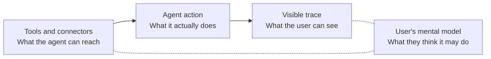

# Harness và mental model: AI làm gì thay người dùng

18/10/2026. Bổ sung cho report "AI Mental Model: Desk Research" (`ai-mental-model-desk-research.md`). Định nghĩa kỹ thuật về harness và agent nằm ở `agentic-ai-concepts.md` mục 5; file này chỉ bàn góc mental model và thiết kế. Nguồn được đọc qua bản tóm tắt của công cụ fetch, chưa phải toàn văn; khi trích vào tài liệu chính thức cần đọc bản đầy đủ. Nhãn bằng chứng: **Có nguồn** (nghiên cứu thực nghiệm), **Guideline** (khuyến nghị, chưa đối chứng), **Suy luận** (của mình).

## 1. Harness là gì, và vì sao khác các lớp khác

Trong mô hình 6 lớp, Harness gồm connectors, tools, skills và agents: phần cho AI khả năng *hành động*, không chỉ trả lời. Mình chưa đọc tài liệu gốc của Emily Campbell (chỉ dựa trên ảnh bạn đưa), và tìm kiếm không thấy nguồn trực tiếp, nên định nghĩa này lấy từ nhãn trong mô hình.

Sự khác biệt về mental model: ở lớp Model và Context, người dùng có thể sai về điều AI *biết hoặc nói*. Ở Harness, họ có thể sai về điều AI *làm*. Hậu quả chuyển từ câu trả lời sai sang hành động đã xảy ra, và Gulf of Evaluation nặng hơn vì người dùng thường không thấy hành động đó. Đây là suy luận từ framework của Norman, không phải kết quả nghiên cứu.

Hai khoảng cách cần canh: giữa điều agent *có thể* chạm tới và điều người dùng *nghĩ* nó được chạm tới, và giữa điều agent *đã làm* và điều người dùng *thấy*.

## 2. Bằng chứng hiện có

**Người dùng hình dung agent bằng ẩn dụ con người.** Phỏng vấn 13 developer tại Microsoft cho thấy họ mô tả hệ thống đa agent như "đội chuyên gia", mô hình front-office/back-office, công trường, hoặc trợ lý mua sắm; agent được coi là thành phần có kỹ năng, công cụ, danh tính, bộ nhớ và khả năng lập kế hoạch ([arXiv 2510.06224](https://arxiv.org/html/2510.06224v1)). Người dùng kỹ thuật muốn kiểm soát xác định; người dùng phi kỹ thuật thích quy trình có hướng dẫn. Các lo ngại chung: lỗi lan truyền, vòng lặp agent không hiệu quả, quy trình mờ đục, rò rỉ dữ liệu. Giới hạn: mẫu nhỏ, một công ty, mới ở mức prototype, và bài không mô tả mô hình quyền hạn nào. **Có nguồn, mức yếu.**

**Người dùng cấp quyền không nhất quán với nhu cầu.** Thí nghiệm 205 người, 7.563 quyết định cấp quyền trong môi trường trợ lý cá nhân mô phỏng: 90% người tham gia cấp quyền không cần thiết ít nhất 15,4% số lần, kể cả khi đã được cảnh báo agent có thể sai ([Wu et al., arXiv 2511.17959](https://www.alphaxiv.org/abs/2511.17959)). Quyết định phụ thuộc ngữ cảnh nhưng ổn định trong cùng ngữ cảnh; với dữ liệu nhạy cảm như số an sinh xã hội, tỷ lệ cấp thiếu quyền lên tới 46,3%. Khi agent xin dữ liệu rõ ràng không liên quan, tỷ lệ "không bao giờ chia sẻ" tăng gần 10%, tức niềm tin vỡ nhanh. Giới hạn: tình huống mô phỏng, không phải triển khai thật; "permission fatigue" là tiền đề của bài, không phải thứ bài đo. **Có nguồn.**

**Hành vi giám sát thay đổi theo kinh nghiệm.** Dữ liệu từ Claude Code của Anthropic: người dùng mới (dưới 50 phiên) bật tự động duyệt toàn phần trong khoảng 20% phiên; sau khoảng 750 phiên con số vượt 40%. Cùng lúc, tỷ lệ ngắt lời agent tăng từ khoảng 5% lên khoảng 9% số lượt. Nhóm tác giả đọc đây là chuyển từ duyệt từng bước sang giám sát và can thiệp khi cần ([Anthropic, Measuring AI agent autonomy](https://www.anthropic.com/research/measuring-agent-autonomy)). Lưu ý: dữ liệu của chính nhà cung cấp, chủ yếu là kỹ sư phần mềm, một phần thay đổi có thể do người dùng chỉnh cài đặt mặc định, và nhãn rủi ro do mô hình gán. **Có nguồn, mức vừa, khó khái quát ngoài lập trình.**

**Guideline có sẵn, chưa đối chứng.** Khung HAX của Cisco/Outshift đề xuất năm nguyên tắc: Control (ranh giới, quyền, mức tự chủ), Clarity (lý do, độ chắc chắn), Recovery (hoàn tác), Collaboration, Traceability (nhật ký hành động); nguồn chủ yếu là khái niệm, từ phỏng vấn hơn 40 chuyên gia, nghiên cứu người dùng chính thức để lại cho công việc sau ([arXiv 2512.11979](https://arxiv.org/pdf/2512.11979)). Microsoft Design (4/2025) nêu: trạng thái agent luôn thấy được, hành động nền xem và điều khiển được, kết nối, công cụ và skills hiển thị và chỉnh được, thể hiện sự không chắc chắn như phần cốt lõi của thiết kế ([UX design for agents](https://microsoft.design/articles/ux-design-for-agents/)). **Guideline.**

## 3. Khoảng trống

Chưa thấy nghiên cứu đo trực tiếp ba thứ mà thiết kế cần: người dùng *hình dung* phạm vi quyền của agent đúng đến đâu so với thực tế; hiển thị công cụ và vết hành động có làm mô hình người dùng chính xác hơn không; và mô hình quyền hạn nào hợp với người dùng nghiệp vụ trong môi trường quy định chặt. Các hạn chế của nguồn trên cũng khiến câu hỏi về người dùng ngoài lập trình viên còn mở.

## 4. Mô hình sai có thể gặp (suy luận)

Ba mô hình sai mình nghĩ cần kiểm chứng đầu tiên:

1. **Chỉ đọc hay cũng ghi.** Người dùng nghĩ agent chỉ xem, trong khi nó có quyền sửa hoặc gửi. Hậu quả nặng nhất vì khó đảo ngược.
2. **Không biết nguồn.** Không biết kết quả đến từ công cụ hay connector nào, nên không đánh giá được độ tin cậy. Khớp với mối lo "quy trình mờ đục" trong nghiên cứu Microsoft.
3. **Mô hình cũ sau khi thêm khả năng.** Thêm connector hoặc skill đổi phạm vi agent mà người dùng không biết. Đây là phiên bản của vấn đề "cập nhật phá mô hình đã học" của Bansal et al., đã nêu trong report chính, ở lớp Harness.

## 5. Việc thiết kế

| Vấn đề mental model | Việc thiết kế | Bằng chứng |
| --- | --- | --- |
| Phạm vi quyền không rõ | Mô tả quyền theo ngôn ngữ người dùng ("đọc thư mục này", không "scope: drive.readonly"); xin xác nhận hành động khó đảo ngược | Guideline (HAX, Microsoft) + Wu et al. |
| Cấp quyền thừa | Mặc định quyền tối thiểu; cảnh báo khi agent xin dữ liệu ngoài nhu cầu của tác vụ | Có nguồn (Wu et al.) |
| Không thấy agent đã làm gì | Nhật ký hành động theo thời gian, có công cụ đã gọi và dữ liệu đã chạm | Guideline |
| Lỗi đã xảy ra | Hoàn tác từng hành động, kèm giải thích bằng ngôn ngữ thường | Guideline (HAX Recovery) |
| Mệt mỏi vì xin duyệt liên tục | Cho phép mức tự chủ tăng dần theo kinh nghiệm; giữ cách ngắt lời và can thiệp luôn sẵn sàng | Có nguồn một phần (Anthropic); mình chưa thấy nghiên cứu độc lập |
| Thêm khả năng mới | Coi mỗi connector hoặc skill mới như một lần đổi model: báo rõ điều gì đổi, kiểm tra lại mô hình người dùng | Suy luận |

Trong bối cảnh ngân hàng, lớp này gắn trực tiếp với Governance: quyền của agent phải khớp với quyền người dùng tin là nó có, và kiểm toán được. Đây là lý do mình đề xuất xử lý Harness và Governance cùng nhau ở Define và Deliver, dù ma trận gốc chỉ đặt Harness ở Develop.

## 6. Research question đề xuất

- Người dùng hình dung phạm vi quyền của agent đúng đến đâu, và sai theo hướng nào (thừa hay thiếu)? Phương pháp: drawing task hoặc elicitation theo kịch bản agent, so với quyền thực tế.
- Nhật ký hành động và hiển thị công cụ có làm mô hình người dùng chính xác hơn, hay chỉ tăng tải nhận thức?
- Mức tự chủ tăng dần theo kinh nghiệm có giữ được giám sát thật, hay chuyển thành duyệt máy móc? Cần dữ liệu ngoài lập trình.
- Với người dùng nghiệp vụ trong môi trường quy định chặt, mô hình quyền hạn nào cân bằng được giữa tự chủ và kiểm toán?

## 7. Harness trong giai đoạn Develop

Trong cộng đồng kỹ thuật, "harness" có nghĩa hẹp hơn: Addy Osmani (19/4/2026) định nghĩa agent là mô hình cộng harness, gồm prompt và file hướng dẫn, công cụ (skills, MCP), hạ tầng (sandbox, filesystem), điều phối (subagent), hook và middleware, và observability ([Agent Harness Engineering](https://addyosmani.com/blog/agent-harness-engineering/)). Ông cho rằng harness quyết định nhiều chất lượng agent: một nhóm đưa agent từ top 30 lên top 5 chỉ bằng cách đổi harness. Đây là kinh nghiệm và giai thoại của tác giả, không phải thí nghiệm đối chứng. Mình dùng nghĩa rộng hơn của mô hình 6 lớp, bao gồm cả phần người dùng nhìn thấy và điều khiển.

Cách áp dụng vào Develop, dưới dạng quy trình đề xuất (Suy luận; các nguyên tắc 2, 4, 5 mượn từ bài của Osmani):

1. **Bắt đầu từ hành vi mong muốn.** Từ kết quả Define (AI được và không được làm gì), suy ra bộ công cụ tối thiểu cần thiết. Mỗi connector hoặc tool thêm vào là thêm một mô hình người dùng cần xây.
2. **Viết "điều kiện xong" trước khi dựng.** Osmani gọi là sprint contract và nói nó bắt lỗi lệch phạm vi tốt hơn mọi chỉnh prompt. Với designer: viết trước ba thứ, agent phải làm gì, không được làm gì, người dùng phải thấy gì sau khi xong.
3. **Thiết kế mô hình quyền hạn như một phần của UI.** Chọn trục kiểm soát (hỏi mỗi lần, allowlist, tự chạy) và mặc định cho từng loại hành động theo mức khó đảo ngược. Xem Cursor và Notion bên dưới.
4. **Thiết kế vết hành động và hoàn tác cùng lúc với công cụ.** Mỗi tool call cần một cách hiển thị và một cách đảo ngược; thêm sau thường tốn hơn.
5. **Coi mỗi lỗi là tín hiệu thiết kế.** Osmani: mỗi lỗi thêm một quy tắc hoặc hook, và gỡ ràng buộc khi mô hình đủ mạnh. Với UX: mỗi lần người dùng ngạc nhiên về hành động của agent là một mental model vỡ, ghi lại để quyết định sửa UI, sửa quyền hay sửa hành vi agent.
6. **Kiểm tra bằng kịch bản, không chỉ bằng màn hình.** Test mô hình người dùng bằng kịch bản agent (hỏi "agent sẽ làm gì, chạm tới gì?" trước khi chạy), kết hợp test với lỗi và edge case thật.
7. **Tách người tạo và người đánh giá.** Osmani nêu agent hay chấm bài của chính nó quá rộng rãi; áp dụng cho review: người đánh giá tính năng agent không nên là người dựng harness.

Phối hợp liên chức năng ở Develop: designer sở hữu mô hình quyền hạn, vết hành động và hoàn tác; engineer sở hữu công cụ, sandbox, hook; PM và risk sở hữu danh sách việc agent được làm. Phân chia này là đề xuất của mình, chưa lấy từ nguồn nào.

## 8. Ví dụ thực tế ở các công ty sản phẩm

Cách đọc: đây là tài liệu và bài đăng của chính nhà cung cấp, cho thấy họ *thiết kế* gì. Chưa có đánh giá độc lập nào về việc các thiết kế này có làm mental model người dùng chính xác hơn hay không.

| Sản phẩm | Quyết định ở lớp Harness | Điều đáng học |
| --- | --- | --- |
| GitHub Copilot agent mode (preview 2/2025) | Bộ công cụ gồm tìm workspace, đọc file, chạy terminal, lấy lỗi compile, áp dụng chỉnh sửa. Lệnh terminal cần người dùng xác nhận. Mọi tool call hiển thị trong UI. Chỉnh sửa hiện dạng đề xuất, có "Undo Last Edit". | Phân loại theo rủi ro: hành động đọc chạy thẳng, chạy lệnh cần duyệt. Hiển thị toàn bộ tool call và đảo ngược được. MCP lúc đó mới ở giai đoạn thăm dò ([VS Code blog](https://code.visualstudio.com/blogs/2025/02/24/introducing-copilot-agent-mode)). |
| Cursor, Run Modes | Ba chế độ: Auto-review (allowlist chạy ngay, phần còn lại qua sandbox hoặc bộ phân loại), Allowlist (dự đoán được hoàn toàn), Run Everything. Có bảo vệ riêng cho xóa file, file ngoài workspace, trình duyệt. Quản trị viên khóa được chế độ ở cấp nhóm. | Mức tự chủ là cài đặt có tên và có mặc định khuyến nghị, không phải một công tắc bật tắt. Tài liệu nói rõ bộ phân loại "không phải ranh giới bảo mật" và có thể sai ([Cursor docs](https://cursor.com/docs/agent/security/run-modes.md)). |
| Notion Agents | Hai loại: Notion Agent kế thừa quyền của người dùng; Custom Agent có quyền riêng "như đồng đội", chọn đọc ghi từng trang. Connector gồm Slack, mail, lịch, Notion MCP. Mọi lần chạy có nhật ký (kích hoạt bởi gì, làm gì, vì sao); hoàn tác bằng lịch sử phiên bản; quản trị viên xem, vô hiệu hóa từng agent. | Hai mô hình quyền hạn cho hai mô hình tinh thần: "trợ lý của tôi" so với "đồng đội có quyền riêng". Trang không mô tả bước duyệt chung trước hành động ([Notion Agents](https://www.notion.com/product/agents)). |
| Salesforce Agentforce | Phạm vi agent định bằng topic và action; topic instructions viết dạng "Luôn…, Không bao giờ…, Nếu x thì y"; quy tắc chuyển người thật; Audit Trail và event log; giới hạn tần suất email agent gửi, cho phép người nhận từ chối, công bố nội dung do AI sinh. | Phạm vi và leo thang được viết thành chính sách đọc được, do admin và lãnh đạo duyệt, không ẩn trong prompt. Phù hợp bối cảnh quy định chặt ([Trailhead](https://trailhead.salesforce.com/content/learn/modules/trusted-agentic-ai/explore-agentforce-guardrails-and-trust-patterns)). |

Điểm chung rút ra (Suy luận từ bốn ví dụ): các sản phẩm này đều phân biệt hành động theo mức rủi ro, đều có vết hành động, đều có cấp độ kiểm soát cho quản trị viên, nhưng khác nhau ở chỗ quyền hạn thuộc về ai (người dùng, agent hay admin) và mức tự chủ mặc định.

Không tìm thấy case study công khai nào cho Intercom Fin hay Shopify Sidekick trong lần tìm này, nên mình không đưa vào. Dữ liệu ngân hàng cụ thể (ví dụ ACB hay NAB) cũng không có nguồn công khai trong lần tìm này.

## Nguồn

- [Exploring Human-AI Collaboration Using Mental Models of Early Adopters of Multi-Agent Generative AI Tools, arXiv 2510.06224](https://arxiv.org/html/2510.06224v1)
- [Wu et al., Towards Automating Data Access Permissions in AI Agents, arXiv 2511.17959](https://www.alphaxiv.org/abs/2511.17959)
- [Anthropic, Measuring AI agent autonomy in practice](https://www.anthropic.com/research/measuring-agent-autonomy)
- [Scibelli et al., Designing the Internet of Agents (HAX), arXiv 2512.11979](https://arxiv.org/pdf/2512.11979)
- [Microsoft Design, UX design for agents (11/4/2025)](https://microsoft.design/articles/ux-design-for-agents/)
- [Addy Osmani, Agent Harness Engineering, 19/4/2026](https://addyosmani.com/blog/agent-harness-engineering/)
- [VS Code, Introducing GitHub Copilot agent mode, 24/2/2025](https://code.visualstudio.com/blogs/2025/02/24/introducing-copilot-agent-mode)
- [Cursor docs, Run Modes](https://cursor.com/docs/agent/security/run-modes.md)
- [Notion Agents](https://www.notion.com/product/agents)
- [Salesforce Trailhead, Agentforce guardrails and trust patterns](https://trailhead.salesforce.com/content/learn/modules/trusted-agentic-ai/explore-agentforce-guardrails-and-trust-patterns)
