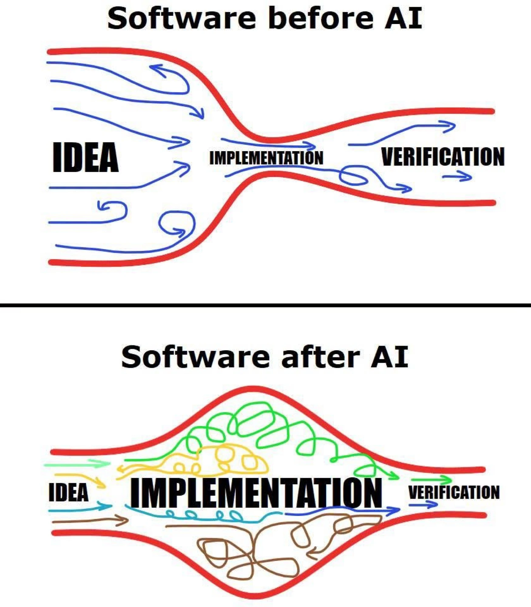

> **Sync note 2026-10-23.** Buổi được đổi theo hình dạng chung của chương trình (ice breaker, theory, một activity, hỏi đáp) và thêm hai phần cho buổi đầu: Agent và đội AI (mục 4.4) và Knowledge Hub. Theory nới lên 44 phút, một activity 18 phút, tổng 82 phút. Bản trước nằm ở `_archive/design-process-with-ai-lesson-pre-agent-hub-2026-10-23.md`. Brief: `learning/briefs/design-process-with-ai-brief.md`.

## Abstract

Tài liệu này mô tả buổi đầu tiên của chương trình AI Design Workflow, dành cho Product Designer và UI/UX Designer ở cấp mid và senior. Module là buổi 1 của chương trình, một buổi 90 phút trình bày bối cảnh, khung kiến thức và một activity ngắn trên lớp. Phần dựng project folder trên case của chính người học chuyển thành bài tập về nhà ngay sau buổi.

Buổi này giải quyết sáu vấn đề, theo thứ tự trình bày:

1. **Định hướng nghề nghiệp.** AI đang thay đổi nghề UI/UX và product design như thế nào, dựa trên các nguồn có thể kiểm chứng, và ba hướng đi mà một designer có thể cân nhắc.
2. **Quy trình thiết kế khi có AI.** Bốn stage của Double Diamond (Discover, Define, Develop, Deliver), các method quen thuộc trong từng stage, việc phân chia giữa phần AI hỗ trợ với phần designer vẫn phải tự thực hiện, những gì AI làm tốt và còn yếu theo bằng chứng, và ba câu hỏi cần trả lời trước khi automate một workflow.
3. **Bộ khái niệm chung** để làm việc với AI tool, gồm bốn khái niệm dạy trên lớp và sáu thuật ngữ tham khảo.
4. **Agent và đội AI** cho product design: agent là gì, mỗi stage cần những vai nào, và đội cần gì để chạy được.
5. **Một project folder và một Knowledge Hub** làm nền cho toàn bộ chương trình: mỗi buổi sau thêm một file hoặc một item vào cùng một case, và hub gom mọi output.
6. **Quy tắc về dữ liệu** an toàn để đưa cho AI tool.

Điểm xuyên suốt ở mọi stage là **AI-assisted, không phải AI-generated**. AI-generated nghĩa là AI đưa ra quyết định. AI-assisted nghĩa là designer quyết định, AI hỗ trợ phần soạn nháp và lắp ráp. Nguyên tắc vận hành ở mọi stage là: **AI soạn nháp. Designer kiểm tra. Designer quyết định.**

Chương trình đặt ra một lập trường: **designer là partner cùng định nghĩa requirement với business và product.** Product, business và design cùng chọn vấn đề đáng giải trước khi build.

**Đối tượng.** Chương trình thiết kế cho Product Designer và UI/UX Designer. Product Owner, Product Manager và Business Analyst có thể học cùng trọn vẹn: cùng stage, cùng project folder, cùng hub. Họ không cần kỹ năng design và không phải build prototype từ đầu; ở phần prototype, họ dùng một design system có sẵn và để AI tạo template từ đó. Ở các buổi sau, những khác biệt theo vai trò được ghi trong mục "Nếu bạn là PO, PM hoặc BA".

**Nhịp học của cả chương trình.** 12 buổi trong 6 tuần, hai buổi online mỗi tuần, mỗi buổi 90 phút, 7 đến 8 học viên. Chín buổi học nội dung (mỗi buổi một lesson); ba buổi Check point (buổi 5, 9, 12) là buổi làm việc trên case của học viên, có coaching. Chuẩn bị tối đa 10 phút trước mỗi buổi (khoảng 25 phút ở buổi 1, gồm kiểm tra tool và pre-read); bài tập về nhà tối đa khoảng 45 phút và chỉ nối tiếp phần đã bắt đầu trên lớp. Buổi live không phụ thuộc vào việc bài tập về nhà đã hoàn thành hay chưa.

**Vị trí của buổi.** Buổi 1 nằm trước bước đầu tiên của workflow. Buổi này giả định người học đã có kinh nghiệm research, UX design và prototyping, và bổ sung lớp AI lên trên những kỹ năng đó.

---

## Learning Objectives

Sau buổi 1, học viên có thể:

1. **Mô tả** ba hướng đi nghề nghiệp (strategic designer, design builder, AI product designer), nêu bằng chứng hiện có và giới hạn của bằng chứng đó, và chọn hướng mình nghiêng về
2. **Nêu**, với mỗi stage trong bốn stage, phần AI giúp được và phần designer vẫn phải tự thực hiện (tên và cách làm từng method nằm ở pre-read và method card, không dạy trên lớp)
3. **Giải thích** bốn khái niệm AI cốt lõi bằng lời của mình: context, grounding, hallucination, và AI-assisted so với AI-generated
4. **Nêu** hai loại task AI làm tốt và hai loại AI còn yếu, kèm một bằng chứng cho mỗi bên, rồi **đánh giá** một workflow có đáng automate hay chưa bằng ba câu hỏi: mục tiêu có rõ không, kết quả khi làm tay có ổn định không, và ai kiểm tra đầu ra
5. **Mô tả** agent là gì, khác gì một lượt hỏi đáp, **phác** một đội AI cho product design (agent theo phase, phần designer giữ lại), và **nêu** Knowledge Hub dùng để làm gì
6. **Phân loại** tài liệu thành ba nhóm (safe, ask first, never in a public tool) và **viết** bản đầu data rules của riêng mình

Sau bài tập về nhà (mục 8.2), học viên có thể:

7. **Cài đặt** project folder của chương trình cho case của chính mình, gồm layout chuẩn, file luật cho AI tool (`AGENTS.md`), context pack đã bắt đầu và một hub Markdown mẫu
8. **Dùng lại** một file đã lưu làm context thay vì mô tả lại project, và yêu cầu AI chỉ rõ nguồn cho từng ý, kèm câu trả lời "unknown" khi không có thông tin
9. **Giải thích** cách chia sẻ hub với stakeholder (tuỳ chọn, theo `guides/04-share-your-hub.md`): mặc định private (PDF, folder nén hoặc mời vào repository private), chỉ công khai cả project folder khi toàn bộ case được phép chia sẻ

---

## Success Check

- Học viên nêu được bốn khái niệm (context, grounding, hallucination, AI-assisted so với AI-generated) bằng lời của mình.
- Học viên nêu được agent khác một lượt hỏi đáp ở điểm nào, và gọi tên ít nhất hai agent trong một đội AI cùng phần designer vẫn giữ.
- `context/data-rules.md` có ba dòng bằng lời của chính học viên.
- Sau bài tập về nhà: project folder dựng đúng layout, `context/product-and-users.md` đủ cụ thể để người ngoài hình dung được người dùng, và `my-direction.md` có hai đến ba dòng.

**Checkpoint trên lớp:** bản đầu của `context/data-rules.md` hoàn thành trong Activity, sau khi học viên tự phân loại năm đoạn trích và so với bản của AI.

---

## 1. Background: AI and the design profession

Nhiều designer đặt câu hỏi: khi AI phổ biến, UI/UX và product design sẽ ra sao? Mục này trình bày những gì các nguồn có thể kiểm chứng cho biết. Mỗi con số được ghi kèm nguồn, năm và cỡ mẫu. Các nguồn được liệt kê ở phần References.

### 1.1 Findings

| # | Phát hiện | Nguồn |
|---|---|---|
| 1 | **Mức dùng AI rất cao.** Trong khảo sát hơn 900 designer tại hơn 60 quốc gia (2026), 91% dùng AI cho công việc design ít nhất mỗi tuần, tăng từ 54% một năm trước; 75% dùng mỗi ngày; trung bình mỗi người thường xuyên dùng 7 AI tool, tăng từ 3 | [1] |
| 2 | **Ranh giới giữa các vai trò mờ đi.** Một nửa số người trả lời đã đưa code do AI tạo ra lên production; 65% làm nhiều việc product hoặc engineering hơn; 40% cho biết PM và engineer làm nhiều việc design hơn | [1] |
| 3 | **Nghề chưa co lại trên số liệu dự báo.** Cục Thống kê Lao động Mỹ (BLS) dự báo số việc làm của web và digital interface designer tăng 7,0% trong giai đoạn 2024 đến 2034 (từ 128.900 lên 137.900), so với 3,1% của mọi ngành. Bảng mới hơn (2025 đến 2035) gộp web developer và digital designer, cho ra 5% (riêng web và digital interface designer: 6%, từ 132.700 lên 140.800, so với 3% của mọi ngành), và ghi rằng việc dùng AI trong phát triển web "may soften" mức tăng. Hai con số dùng cách gộp nghề và năm gốc khác nhau, nên không so sánh trực tiếp | [4], [5] |
| 4 | **Áp lực lộ ra ở entry level.** Nielsen Norman Group (NN/g) nhận định thị trường UX đang ổn định sau giai đoạn 2023 đến 2024, nhưng vị trí entry-level vẫn "scarce and highly competitive" trong khi vị trí senior phục hồi nhanh hơn | [3] |
| 5 | **Cơ chế tác động.** Nghiên cứu của Stanford trên dữ liệu bảng lương ADP cho thấy người đi làm sớm (22 đến 25 tuổi) trong các nghề chịu tác động mạnh nhất của AI có việc làm thấp hơn khoảng 19% so với mức lẽ ra có nếu theo kịp nhóm cùng tuổi ở các nghề ít chịu tác động (dữ liệu ADP đến 06/2026, bản cập nhật 08/2026). Nhóm có kinh nghiệm không có khoảng cách tương tự; mức giảm tập trung ở nơi AI thay thế thay vì hỗ trợ công việc. Nghiên cứu xét mọi nghề, không tách riêng designer | [6] |

### 1.2 Interpretation

Từ các phát hiện trên, tài liệu rút ra hai nhận định. Cả hai là **suy luận**, không phải kết quả đo trực tiếp.

- **Phần việc bị nén nhanh nhất là từ brief sang screen.** Vị trí thiên về execution ở entry level (wireframe, sản xuất asset) là nơi áp lực rõ nhất [3], [6]. Không có nguồn nào đo trực tiếp nhóm "designer nhận brief rồi làm screen"; nhận định này suy ra từ cơ chế ở phát hiện 4 và 5.
- **Phần còn lại là phần AI chưa làm thay được:** chọn vấn đề đáng giải, thống nhất thế nào là thành công, và kiểm tra những gì AI soạn nháp. NN/g mô tả những practitioner thành công là "adaptable generalists", coi UX là việc giải quyết vấn đề mang tính chiến lược, không phải sản xuất deliverable [3].

### 1.3 Limitations of the evidence

- Khảo sát designer [1] là tự khai báo và không dùng mẫu ngẫu nhiên; "91% designer" nên được hiểu là 91% những designer đã trả lời. Khảo sát do bên có lợi ích trong lĩnh vực design và AI tooling thực hiện.
- Dự báo của BLS tính tác động của AI còn hạn chế và bản 2024 đến 2034 có trước phần lớn những thay đổi gần đây.
- Chưa có nguồn nào cho thị trường Việt Nam ở cấp độ designer. Số liệu ở trên chủ yếu về thị trường Mỹ và toàn cầu.
- Một số số liệu thường thấy trong các bài viết nghề nghiệp (ví dụ mức giảm tin tuyển junior theo phần trăm, hay mức tăng của từng chức danh) không truy ngược được nguồn và không được dùng ở đây.

---

## 2. Career directions

Ba hướng đi dưới đây không loại trừ nhau, và chúng mô tả xu hướng chứ không phải sự đảm bảo. Mức bằng chứng được ghi để người đọc cân nhắc.

| Hướng | Công việc chính | Kỹ năng trọng tâm | Bằng chứng và giới hạn | Chương trình này hỗ trợ |
|---|---|---|---|---|
| **Strategic designer** (senior generalist) | Cùng product và business chọn vấn đề đáng giải; research, framing, ra quyết định | Research, framing, stakeholder management, judgment | NN/g 2026: vị trí senior và generalist phục hồi nhanh hơn [3]; nghiên cứu Stanford cho thấy nhóm có kinh nghiệm ổn định [6]. **Mức vừa:** một bài phân tích có thẩm quyền cộng một nghiên cứu gián tiếp | Buổi 2 đến 5 (Discover, Define, Check point 1); hub làm bằng chứng cho lập luận |
| **Design builder** (design engineer) | Dựng prototype chạy được và đưa lên production bằng AI coding tool | Design system, kiểm tra các file mà AI coding tool đã sửa, đọc output | Một nửa designer được khảo sát đã đưa code do AI tạo lên production [1]. **Mức vừa** về xu hướng; số liệu tuyển dụng thì yếu | Buổi 7 đến 9 (prototype, refine, Check point 2) |
| **AI product designer** | Thiết kế sản phẩm có AI bên trong: hành vi, ranh giới, lỗi và niềm tin của người dùng | Hiểu hallucination và grounding, đánh giá output, conversation design | NN/g và các nguồn nghề nghiệp nêu đây là chuyên môn đang lên [3]; số liệu tăng trưởng chưa đáng tin. **Mức yếu** | **Chỉ có nền tảng.** Chương trình dạy cách dùng AI để làm việc, không dạy thiết kế sản phẩm AI |

UX research là một hướng liên quan: NN/g nêu research và stakeholder management là những kỹ năng tạo khác biệt [3]. Hướng thiên về execution ở entry level (wireframe, sản xuất asset) là hướng chịu áp lực nhiều nhất theo các nguồn trên, và là lý do để chọn hướng sớm.

Sau buổi 1, ở bài tập về nhà, học viên ghi hai đến ba dòng vào `_personal/my-direction.md` (hướng nghiêng về, lý do, một kỹ năng muốn xây trong chương trình). File được xem lại ở buổi 12 và có thể thay đổi. File nằm ngoài context pack vì là ghi chú riêng của học viên, không đưa cho AI tool.

---

## 3. The design process with AI

### 3.1 The four stages

Double Diamond gồm bốn stage; output của stage này là input của stage kế tiếp. Với người đã học phiên bản Design Thinking năm stage, hai mô hình tương ứng như sau: Empathise là **Discover**, Define là **Define**, Ideate và Prototype là **Develop**, Test là **Deliver**.

| Stage | Hình dạng | Tạo ra |
|---|---|---|
| **Discover** | Mở rộng: hiểu người dùng và bối cảnh | Evidence, research thô |
| **Define** | Thu hẹp: diễn giải các phát hiện | Insight, opportunity, design challenge |
| **Develop** | Mở rộng rồi thu hẹp: brainstorm, select, prototype | Một hướng đã chọn và một prototype |
| **Deliver** | Thu hẹp: test và bàn giao | Findings, handoff pack, measurement plan |

Mỗi stage kết thúc bằng một checklist ngắn gọi là **gate** trước khi công việc đi tiếp. Chi tiết từng method và từng gate nằm ở các buổi dành cho stage đó. Ở buổi 1, phần này chỉ trình bày mỗi stage gồm gì và AI hỗ trợ ở đâu; từng method được đọc trước trong pre-read brief và có method card riêng.

### 3.2 Methods and the division of work

Câu hỏi áp dụng cho mọi stage: **AI hỗ trợ được ở đâu, và phần nào designer vẫn phải tự thực hiện?**

| Stage | Method | AI hỗ trợ | Designer vẫn tự thực hiện |
|---|---|---|---|
| **Discover** | Research questions, desk research, competitor analysis, stakeholder meetings, questionnaire, user interviews, observation | Soạn nháp research questions, interview guide và questionnaire; đọc desk research và nguồn competitor đã thu thập rồi rút ra dữ kiện; phiên âm và tóm tắt các session | Chọn câu hỏi; nói chuyện và quan sát người thật; đối chiếu mọi bản tóm tắt với ghi chú gốc. **AI không phải là user và không thể thay thế user** |
| **Define** | Năm bước: identify themes, sort and cluster, define insights, frame opportunities, set design challenges. Công cụ thường dùng: empathy map, assumption map, jobs to be done, How Might We, current-state journey map, Lean UX canvas | Đề xuất theme và cluster từ ghi chú thô; soạn nháp insight statement và câu How Might We; chỉ ra chỗ evidence còn mỏng | Quyết định theme nào quan trọng; xếp hạng opportunity; thống nhất design challenge với product và business. **AI không đóng vai người phía product và business** |
| **Develop** | Brainstorm (Crazy 8s, How Might We ideation, brainwriting); select (impact vs effort, concept sketching, storyboarding); prototype (wireframes, interactive prototype, proof of concept) | Mở rộng tập ý tưởng và các biến thể; với AI coding tool, dựng prototype đầu tiên từ flow và design system | Chọn hướng đi và ghi lại lý do; kiểm tra từng decision với user need và các principle |
| **Deliver** | Internal feedback session, concept testing, usability testing (moderated hoặc unmoderated), A/B testing; handoff pack và kế hoạch đo lường thành công | Soạn nháp test plan và script; sắp xếp ghi chú; soạn nháp handoff | Chạy session với user thật; xếp findings theo mức độ quan trọng, không theo số lần được nhắc. **AI không thay thế user thật** |

Ở mọi stage, method thuộc về designer; AI giúp soạn nháp nhanh hơn, còn việc kiểm tra thuộc về designer. Mỗi method có một card tham khảo một trang (là gì, vì sao, khi nào, cách làm, AI hỗ trợ ở đâu, phần designer tự thực hiện): [mục lục method card](../../../assets/method-cards/README.md).

### 3.3 The partner stance

Một brief tốt từ product là điểm xuất phát tốt. Phần AI làm nhanh nhất là biến brief thành screen. Phần AI không làm thay được là cùng product và business chọn vấn đề đáng giải và thống nhất thế nào là thành công. Việc này cần cả hai phía: design tham gia sớm với evidence; product và business chia sẻ những gì họ biết về vấn đề, outcome và ràng buộc. Mục tiêu là hai cách nhìn gặp nhau trước khi build, không phải sửa lại công việc của bất kỳ bên nào.

Mức độ làm việc chung với product khác nhau giữa các học viên: có người làm sát product mỗi ngày, có người chỉ liên lạc qua trung gian, có người chưa có cơ hội trao đổi. Chương trình vận hành được trong cả ba trường hợp; buổi 2 (Discover the Problem) trình bày cách làm.

### 3.4 What AI is good at, and where it falls short

Mục 3.2 trả lời AI hỗ trợ được ở đâu. Mục này cho biết giới hạn của câu trả lời đó, dựa trên các nghiên cứu có đối chứng và benchmark.

**Phát hiện từ nguồn.**

| Loại việc | Phát hiện | Nguồn, năm, cỡ mẫu |
|---|---|---|
| Tác vụ viết chuyên nghiệp | Thời gian giảm khoảng 40%, chất lượng tăng khoảng 18% | Noy và Zhang, Science, 2023, 453 người [13] |
| Task nằm trong khả năng của mô hình | Nhanh hơn khoảng 25%, chất lượng cao hơn khoảng 40%. Task nằm ngoài khả năng cho kết quả tệ hơn nhóm không dùng AI | Harvard và BCG, 2023, 758 consultant [14] |
| Một task code độc lập | Hoàn thành nhanh hơn khoảng 55% (khoảng tin cậy 21 đến 89%) | GitHub, 2022, 95 developer [15] |
| Developer giàu kinh nghiệm trên codebase quen thuộc | Chậm hơn 19% | METR, 2025, 16 developer [16] |
| Một công việc freelance trọn vẹn | Agent tốt nhất tự hoàn thành khoảng 2,5% dự án khi ra mắt; các cập nhật sau đó cao hơn nhiều: bảng xếp hạng ngày 22/10/2026 có mô hình đứng đầu trên 21% | Scale AI và CAIS, Remote Labor Index, 2025 và 2026 [17] |
| Tổng hợp nghiên cứu UX | Phiên âm và tóm tắt hữu ích nhưng cần kiểm lại; phần code và nhóm dữ liệu do AI tạo chỉ nên coi là bản đầu, vì có thể bỏ sót và nhóm hời hợt | Nielsen Norman Group, 2024 (xem lại 01/2026) [18] |

**Suy luận của tác giả.** AI mạnh ở task có giới hạn rõ, đầu ra kiểm tra được nhanh và gần với viết, tóm tắt hoặc dựng bản đầu. AI yếu hơn ở task dài, nhiều bước, cần phán đoán hoặc bối cảnh mà chỉ người trong team biết. Hai điểm đáng nhấn:

- **Kết quả yếu thường trông ổn.** Một khảo sát 1.150 desk worker (nhân viên làm việc văn phòng) toàn thời gian ở Mỹ ghi nhận 40% nhận sản phẩm AI trông như đã xong nhưng thiếu nội dung trong tháng qua, và mỗi lần mất trung bình khoảng hai giờ để xử lý [19].
- **Người có kinh nghiệm không tự động nhanh hơn.** Developer ở nghiên cứu METR chậm hơn 19% dù tự cảm thấy nhanh hơn khoảng 20% [16]. Đây là kết quả của đầu 2025; METR nay ghi các kết quả này đã cũ, và bản cập nhật 02/2026 cho rằng công cụ mới nhiều khả năng giúp nhiều hơn, nhưng chưa có số đo đáng tin.

Các số liệu về agent thay đổi theo từng phiên bản mô hình, nên nhận định "AI mạnh hay yếu" chỉ đúng với một loại task và một thời điểm.

### 3.5 Before automating a workflow

Các mục trên cho biết AI hỗ trợ được ở đâu và còn yếu ở đâu. Câu hỏi cần trả lời trước đó là workflow này có đáng được tăng tốc hay không.

**Phát hiện từ nguồn.**

- Báo cáo DORA 2025 (khảo sát gần 5.000 người làm công nghệ) mô tả AI như một bộ khuếch đại. Throughput tăng, độ bất ổn cũng tăng, và AI phóng đại cả điểm mạnh lẫn điểm yếu của team [20]. Số liệu này đến từ phát triển phần mềm.
- Từ năm 1990, Michael Hammer đã lập luận rằng dùng công nghệ để làm nhanh quy trình cũ không tạo ra bước nhảy; phần việc không tạo giá trị nên được bỏ [21].

**Suy luận của tác giả.** Khi AI làm đầu ra rẻ đi, chi phí chuyển sang bước kiểm tra. Một workflow thiếu mục tiêu rõ hoặc thiếu gate sẽ chuyển lỗi sang stage sau nhanh hơn. Với designer, đây là suy luận từ hai nguồn trên chứ không phải kết quả đo trên công việc design.



*Hình minh hoạ trực quan cho ý trên, không phải số liệu. Khung lý thuyết gần nhất với hình là Theory of Constraints (Goldratt, *The Goal*, 1984): hiệu suất của cả hệ thống bị giới hạn bởi điểm nghẽn, và khi gỡ một điểm nghẽn thì nó dịch sang chỗ khác. Đây là lý thuyết nền chung; áp vào công việc design là suy luận, và nguồn gốc chưa được đọc lại [to confirm]. Nguồn: ảnh lưu truyền trên mạng, chưa truy ra tác giả [to confirm].* Trước AI, dòng ý tưởng bị siết ở bước implementation. Sau AI, implementation rộng ra nên ý tưởng và bản nháp đi vào nhiều hơn, nhưng bước verification vẫn hẹp, nên phần chưa kiểm tra dồn lại ở đó. Với designer: AI tạo mười hướng trong vài phút, còn việc chọn hướng đúng và kiểm tra với người dùng thật thì không nhanh theo.

**Quy tắc của chương trình:** sửa hoặc bỏ workflow trước, rồi mới dùng AI.

Ba câu hỏi trước khi automate:

1. Workflow này nhằm đạt điều gì, và thế nào là kết quả tốt, trong một câu?
2. Khi làm tay, workflow cho kết quả ổn định không?
3. Ai kiểm tra đầu ra, và dựa trên cái gì?

Câu trả lời "không" ở câu 1 hoặc 2: sửa hoặc bỏ workflow trước. Câu trả lời "không" ở câu 3: thêm một gate và một người chịu trách nhiệm. Checklist đầy đủ tám câu nằm ở handout `before-you-automate.md`, gửi riêng cho học viên.

---

## 4. Working with AI: core concepts

### 4.1 Four concepts

Chỉ bốn khái niệm được dạy trên lớp, gắn vào demo ở 4.2. Học viên là designer mid và senior, đã dùng AI hằng tuần, nên buổi không đọc định nghĩa; chỉ gọi tên những gì họ vừa thấy trong demo.

| Khái niệm | Định nghĩa | Hệ quả thực hành |
|---|---|---|
| **Context** | Mọi thứ AI nhìn thấy tại thời điểm đó: instruction, text đã dán, file đính kèm, các tin nhắn trước. Tài liệu dài và lộn xộn làm kết quả kém chính xác | Đưa đúng tài liệu vào, chỉ những phần một bước cần; AI không biết gì khác về project |
| **Grounding** | Gắn câu trả lời với tài liệu được cung cấp, không dựa vào kiến thức chung của AI | "Chỉ dùng tài liệu bên dưới. Mỗi ý lấy từ đâu?" |
| **Hallucination** | Câu trả lời tự tin nhưng bịa: một đối thủ không tồn tại, một câu quote chưa ai nói | Yêu cầu nguồn cho từng ý; cho phép AI trả lời "unknown" |
| **AI-assisted so với AI-generated** | AI-generated: AI quyết định. AI-assisted: designer quyết định, AI lắp ráp | AI soạn nháp. Designer kiểm tra. Designer quyết định |

### 4.1b Six reference terms (pre-read)

Không dạy trên lớp ở buổi 1. Học viên đọc trong pre-read; mỗi thuật ngữ được dạy lại đúng buổi cần nó.

| Thuật ngữ | Định nghĩa | Hệ quả thực hành | Dạy sâu ở |
|---|---|---|---|
| **AI chat tool** | Người dùng viết, AI trả lời. Phù hợp cho tổng hợp, lên ý tưởng, viết | Dùng sâu một tool trước khi thử nhiều tool | Dùng từ buổi 1 |
| **AI coding tool** | Đọc và ghi file trong project folder; dựng prototype chạy được | Cung cấp flow và design system | Buổi 7 |
| **Context window** | Giới hạn lượng thông tin AI giữ được cùng lúc | Chỉ đưa những phần mà một bước cần | Nhắc trong 4.1 (context) |
| **Agent** | Tool tự thực hiện nhiều bước: đọc file, sửa, chạy lệnh, rồi báo lại | Kiểm tra các file đã bị sửa, không chỉ câu trả lời | Giới thiệu ở buổi 1 (mục 4.4); dạy sâu ở buổi 7 |
| **Connector (MCP)** | Giống một cái USB: cắm giữa file design hoặc tài liệu và AI tool để AI đọc được thứ đang làm [7] | Trước khi kết nối, xác định nó đọc và sửa được những gì | Buổi 7; nhắc một dòng ở data safety (5.3) |
| **Reusable instructions** (skills, rules file, project memory) | Instruction đã lưu, bộ quy tắc chung của project, hoặc context project đã lưu [7] | Viết một lần, dùng lại nhiều lần | Buổi 7 (`AGENTS.md` ở 6.2 là ví dụ đầu tiên) |

Ba khái niệm phụ không đưa vào bảng: **model** là phần lõi phía sau một tool, **prompt** là thứ người dùng đưa cho AI, và **in-tool AI features** là các tính năng AI có sẵn trong design tool.

### 4.2 Worked example: one task, done twice

Ví dụ minh hoạ dùng một case hư cấu của chương trình.

*Case card (Kitchen Crate, hư cấu):* một app meal-kit theo gói đăng ký. Nhiều khách hàng mới tạm dừng sau hộp đầu tiên. Team muốn cải thiện onboarding. App có date picker chọn ngày giao, một màn hình menu và một bước thanh toán. Team nghi ngờ giá là lý do khách rời đi. Chưa có research nào được thực hiện.

- **Instruction 1 (mơ hồ):** "Làm sao để cải thiện onboarding cho app meal-kit của tôi?"
- **Instruction 2 (có cấu trúc, đính kèm case card):** "Chỉ dùng case card. Liệt kê năm điều quan trọng nhất bạn cần biết mà KHÔNG có trong đó, và nói vì sao mỗi điều quan trọng. Không đoán, không dùng kiến thức chung để lấp chỗ trống. Nếu chỗ nào chưa rõ, trả lời 'unknown'. Chỉ trả về danh sách."

**Quan sát điển hình.** Instruction 1 thường cho lời khuyên tự tin nhưng chung chung, và có thể nói về sản phẩm như thể đó là sự thật. Instruction 2 thường hỏi đúng những điều chỉ research hoặc business mới trả lời được.

**Diễn giải theo thuật ngữ.** Case card là **context**; "chỉ dùng case card" là **grounding**; lời khuyên tự tin của instruction 1 là rủi ro **hallucination**; câu trả lời "unknown" là lý do instruction 2 hữu ích. Cho phép AI trả lời "unknown" thường giúp giảm việc lấp chỗ trống bằng nội dung bịa; đây là giả định thực hành được kiểm nghiệm lại ở bài tập về nhà (bước 4), không phải kết quả đã được đo trong tài liệu này. Khái niệm thứ tư, **AI-assisted so với AI-generated**, là lập trường đã nói ở đầu buổi: ở demo, designer là người chọn bản nào đáng tin.

### 4.3 Reuse rather than retype

Một cuộc hội thoại AI mới không biết gì về project. Trước khi mô tả project từ trí nhớ, cần đính kèm file đã lưu. Một instruction tốt gồm các thành phần: nêu rõ tài liệu cần dùng; yêu cầu một task duy nhất; quy định "chỉ dùng tài liệu này, nêu nguồn cho từng ý, trả lời 'unknown' nếu tài liệu không nói, chỉ trả về section của mình"; và nêu định dạng mong muốn. Cấu trúc này tương ứng với khung CARE của NN/g [8]; tổng quan rộng hơn về dùng AI trong UX có ở [9].

**Mẫu instruction:** "Tôi là UX designer đang làm [case trong một hoặc hai câu]. Đây là context file: [đính kèm context/product-and-users.md]. Chỉ dùng file này, hãy viết instruction nên dùng để nhờ bạn [task cụ thể]. Sau đó phản biện chính instruction đó: chỗ nào còn mơ hồ, chỗ nào có thể trả lời bằng cách đoán, và cần thêm gì để có thể nói 'unknown' thay vì đoán."

### 4.4 Agents and an AI team

Mục này giới thiệu ở mức khái niệm. Học viên chưa dựng đội trong buổi 1; đội được giao việc thật từ buổi 7.

**Agent.** Theo cách phân loại của Anthropic, workflow là hệ thống mà mô hình và tool được điều phối theo đường đi định sẵn trong code, còn agent là hệ thống trong đó mô hình tự quyết định quy trình và việc dùng tool ở thời điểm chạy, cho đến khi xong hoặc cần hỏi người [22]. Một lượt hỏi đáp trong AI chat tool không phải agent: ở đó người dùng quyết định bước tiếp theo từng lượt. Vòng lặp của agent gồm nhận mục tiêu, lập kế hoạch, hành động bằng tool, quan sát kết quả, rồi dừng khi đạt điều kiện [22].

Hệ quả thực hành có hai điểm. Câu trả lời của agent là bản tóm tắt, còn kết quả thật nằm ở các file nó đã sửa, nên việc kiểm tra là kiểm tra file. Agent vẫn có thể báo xong khi chưa xong, cùng cơ chế "kết quả yếu thường trông ổn" ở mục 3.4.

**Agent đầu tiên.** Trong chương trình, một agent đầu tiên được dựng theo năm bước, đây là phương pháp của chương trình chứ không phải kết quả nghiên cứu: (1) mở AI coding tool trên project folder; (2) giao một vai và một kết quả cụ thể, ví dụ agent Competitor Analysis là step card `toolkit/skills/competitor-analysis.md`, đọc nguồn đã ẩn danh trong `work/sources/anonymised/` và điền từng mục của `work/competitor-analysis.md` (mục AI soạn không được sửa, bản đã đối chiếu do designer ghi riêng); (3) chạy thử, mở file kết quả, đối chiếu với nguồn rồi chỉnh chỉ dẫn; (4) ghi kết quả ra file Markdown trong `work/`, và chỉ nối sang Excel hoặc email qua connector sau khi file Markdown đã ổn; (5) khi một lần chạy đã ổn, nhờ tool ghi lại cách làm thành step card để dùng lại. Bước 3 là bước không bỏ được, vì agent có thể báo xong khi kết quả thiếu nguồn. `AGENTS.md` ở bước này chỉ là quy tắc chung của folder; việc điều phối các agent vẫn do designer làm qua gate. Step card Competitor Analysis tự ghi trạng thái draft, chưa được thử với một lớp thật (ảnh: `assets/competitor-analysis-step-card.webp`).

**Đội AI cho product design.** Trong chương trình, đội AI là một cách tổ chức công việc: mỗi agent là một instruction, một input riêng và một output ghi vào file; designer dẫn dắt, kiểm tra và quyết định. Sơ đồ dưới đây đặt hai agent vào mỗi phase của Double Diamond, tám agent cùng đọc và ghi một design memory dùng chung, và designer duyệt ở mỗi lần chuyển phase.


*Sơ đồ đội AI của chương trình. Cấu trúc theo các nghiên cứu đã công bố (LacAIDes, MAUX); tên và phạm vi agent là của chương trình.* Bảng dưới minh hoạ trên case Kitchen Crate.

| Phase | Agent | Ví dụ output | Designer vẫn tự làm |
|---|---|---|---|
| Discover | 01 Desk research agent | Dữ kiện từ review công khai và đối thủ, kèm nguồn | Chọn research questions; đối chiếu với nguồn gốc |
| Discover | 02 Interview agent | Interview guide và bản tóm tắt transcript | Gặp người thật; kiểm tra tóm tắt với ghi chú gốc |
| Define | 03 Synthesis agent | Theme, cluster và insight nháp | Chọn theme nào quan trọng |
| Define | 04 Framing agent | Problem statement và câu How Might We nháp | Thống nhất design challenge với product và business |
| Develop | 05 Ideation agent | Concept, biến thể và trade-off | Chọn hướng và ghi lý do |
| Develop | 06 Prototype agent | Flow, màn hình và prototype bản đầu | Kiểm tra với design system và user need |
| Deliver | 07 Test agent | Test plan, script và bản nháp findings | Chạy session với người dùng thật; xếp findings theo mức độ quan trọng |
| Deliver | 08 Handoff agent | Handoff spec và kế hoạch đo | Duyệt trước khi bàn giao |

Hai vai không giao cho AI: người dùng thật và người phía product và business (xem mục 3.2). Sơ đồ không có agent nào duyệt thay designer; chỗ duyệt giữa các phase là việc của designer, vì một agent duyệt cũng có thể sai.

**Điều kiện để đội chạy được.** Đội cần bốn thứ nằm trong project folder: context pack (file đã lưu thay vì mô tả từ trí nhớ), step card trong `toolkit/skills/` (mỗi bước ai làm, đọc file nào, ghi vào đâu), gate (checklist ngắn trước khi công việc đi tiếp) và reusable instructions (`AGENTS.md`). Thêm vai khi chưa có bốn thứ này không làm đội tốt hơn; theo mục 3.5, workflow chưa ổn chạy nhanh hơn thì lỗi cũng đến nhanh hơn.

**Cách setup agent và flow.** Đội AI trong chương trình không gồm tám công cụ riêng. Cách setup có năm phần, tất cả nằm trong project folder và `workspace-template`:

1. **Một AI coding tool mở cả project folder** làm project của nó.
2. **`AGENTS.md` ở gốc folder là quy tắc chung.** Tool tự đọc file này khi mở folder; trong đó có luật propose first (đề xuất trước khi tạo hoặc sửa nhiều file) và luật không đọc `_personal/` và `work/sources/_raw-private/`.
3. **Mỗi agent là một step card**, một file Markdown trong `toolkit/skills/`, ghi bước đó đọc file nào, làm gì và ghi vào đâu. Chạy một agent nghĩa là nhờ tool đọc step card của bước đó, sau khi đọc context pack trong `context/`.
4. **Output ghi vào file**: tài liệu trong `work/`, item (decision, evidence, finding...) trong `insights/` qua `new-item.py`. Design memory chính là project folder cộng hub, và hub được dựng lại bằng `refresh-hub.md` và `build-report.py`.
5. **Gate là tiêu chí trong `standards/`** (gates, principle checks, severity levels), dùng để designer kiểm tra trước khi sang phase sau.

Flow của một bước: designer ra lệnh, tool đọc step card và context, tool đề xuất, designer duyệt, tool ghi file, designer kiểm tra theo gate, rồi mới sang bước tiếp. Mũi tên REVIEW trong sơ đồ chính là gate này.

*Hiện trạng của toolkit (kiểm tra 2026-10-24):* có step card cho competitor analysis (agent 01), interview (agent 02), user-voice synthesis và add insights (agent 03), framing (agent 04), ideation (agent 05), prototype (agent 06), test (agent 07), handoff (agent 08), cùng các card hạ tầng (new item, refresh hub, export hub, add media, build process map). Cả tám card đều là bản nháp, chưa được thử với một lớp thật; mỗi card được chỉnh sau lần chạy đầu ở buổi tương ứng.

**Giới hạn.** Cách chia vai ở trên là phương pháp của chương trình, không phải kết quả nghiên cứu; chưa có nguồn nào đo hiệu quả của một đội agent trong công việc design [to confirm].

---

## 5. Data safety

Mục này là hướng dẫn thực tế, **không phải tư vấn pháp lý**; chính sách của công ty và luật địa phương là căn cứ quyết định.

### 5.1 Why it matters

PRD, design chưa phát hành, user research có tên người, file của client và số liệu tài chính thường là thông tin confidential hoặc nằm dưới NDA. Nhiều công ty giới hạn nhân viên được dùng AI tool nào. Ở Việt Nam, dữ liệu cá nhân được điều chỉnh bởi Luật Bảo vệ dữ liệu cá nhân số 91/2025/QH15, do Quốc hội thông qua ngày 26 tháng 6 năm 2025 và có hiệu lực từ ngày 1 tháng 1 năm 2026 [10]. Nghị định 356/2025/NĐ-CP, ban hành ngày 31 tháng 12 năm 2025 và có hiệu lực cùng ngày với luật, quy định chi tiết việc thi hành luật và thay thế Nghị định 13/2023/NĐ-CP [11]. Tên, email, số điện thoại và bản ghi của người dùng đều là dữ liệu cá nhân. Văn bản hiện hành cần được kiểm tra trực tiếp hoặc hỏi công ty.

Dữ liệu đưa vào AI tool được xử lý thế nào còn tuỳ tool và gói sử dụng. Các nhà cung cấp AI tool lớn công bố cách tiếp cận hai lớp: ở gói consumer, người dùng có lựa chọn cho phép hay không cho phép dùng hội thoại để cải thiện model, và lựa chọn này có thể đi kèm thời hạn lưu trữ khác nhau; gói business, enterprise và API thường không dùng dữ liệu của khách hàng để train theo mặc định [12]. Cài đặt và điều khoản thay đổi thường xuyên, nên cần đọc trực tiếp trang data controls và điều khoản của tool đang dùng. Không nên mặc định rằng dữ liệu là private.

### 5.2 Three classes of material

| Nhóm | Ví dụ | Quy tắc |
|---|---|---|
| **Safe**: thông tin công khai, suy nghĩ của chính mình, case hư cấu | Trang giá công khai của một đối thủ; ghi chú về một app công khai; case card của chương trình | Dùng được với bất kỳ tool nào đã chấp nhận |
| **Ask first**: nội bộ nhưng không nhạy cảm | Ghi chú quy trình nội bộ; tóm tắt research chưa công bố và không có tên người | Chỉ dùng trong tool mà công ty đã duyệt |
| **Never in a public tool**: dữ liệu cá nhân, kế hoạch chưa phát hành, tài chính, tài liệu NDA | Transcript phỏng vấn có tên; danh sách khách hàng; spec chưa phát hành; ảnh chụp admin dashboard đang chạy thật | Không dán. Ẩn danh trước, dùng tool đã được duyệt, hoặc để ngoài |

### 5.3 Four habits before pasting

1. **Kiểm tra chính sách.** Nếu chưa có thì hỏi; còn phân vân thì không dán.
2. **Phân loại tài liệu** theo ba nhóm trên.
3. **Xoá thông tin định danh trước**, bằng find and replace trên máy của mình chứ không nhờ AI làm, vì khi đó dữ liệu đã được gửi đi. Ẩn danh không phải lúc nào cũng hoàn hảo.
4. **Giữ file confidential ngoài folder của tool**, vì AI coding tool hoặc agent đọc toàn bộ project folder. Dữ liệu gốc cần ẩn danh nằm trong `sources/_raw-private/`: folder này không lên GitHub và file luật bảo tool không đọc, nhưng đó là quy tắc chứ không phải rào chắn kỹ thuật; file thật sự confidential vẫn để ngoài folder. Cùng nguyên tắc với **connector** (cho AI tool đọc thẳng file design hoặc tài liệu trong Figma, Notion...): trước khi kết nối, xác định nó đọc và sửa được những gì, và áp data rules như khi dán.

Việc output của AI có được dùng cho công việc với client hay không, và quyền sở hữu thuộc về ai, tuỳ thuộc công ty và quốc gia. Nên ghi lại trong `project-log.md` những chỗ đã dùng AI.

Output của mục này là `context/data-rules.md`: ba dòng bằng lời của chính học viên (được dán gì, sẽ không dán gì, dùng tool nào cho việc gì), được viết trong Activity ngay trên lớp ở buổi 1.

---

## 6. The workspace

### 6.1 File formats and location

- **Markdown (`.md`)** là tài liệu làm việc: plain text với vài ký hiệu đơn giản (`## Heading`, `**bold**`, danh sách `-`, bảng `|`), là định dạng phổ biến mà AI tool xử lý ổn định và dễ cung cấp có chọn lọc.
- **HTML** là phần trình bày, thứ browser hiển thị. Prototype do AI dựng là file HTML. Hub vẫn là Markdown: các folder Markdown xem và sửa được bằng AI coding tool, VS Code, Obsidian (có Graph view và Backlinks) hoặc GitHub mà không cần dựng website. Designer giữ phần Markdown; khi stakeholder cần đọc, export ra PDF.
- **Local folder.** Case được giữ trong một folder local, không phải tài liệu trên cloud: AI coding tool mở cả folder làm project của nó và đọc mọi thứ bên trong, còn folder đồng bộ cloud có thể gặp lỗi khi đang ghi file. Folder lộn xộn cho output lộn xộn.

### 6.2 Project folder

```
[project-name]/
├── index.html           báo cáo của project: một file HTML xuất từ các file Markdown, mở bằng trình duyệt
├── README.md            Project card (tên, câu hỏi business, stage hiện tại) và việc nên làm tiếp
├── AGENTS.md            file luật cho AI tool: bản đồ folder, thứ tự đọc, các luật cứng
├── context/             context pack: product-and-users, data-rules, accessibility-rules, glossary, open-questions,
│                        design-system-notes (thêm ở buổi 7)
├── work/                mọi thứ làm ra trong project: phân tích, persona, wireframe, prototype (mỗi tài liệu một file hoặc một folder)
│   └── sources/         anonymised/ (AI đọc) và _raw-private/ (AI không đọc, không lên GitHub)
├── insights/            những gì học được và các quyết định: opportunities, hypotheses, metrics, decisions, evidence, findings,
│                        project-log.md (mỗi decision một dòng, kèm lý do)
├── stages/              câu chuyện của từng stage, do hub tự dựng
├── standards/           thước đo công việc: gates, principle-checks (viết ở buổi 4), severity-levels
└── _personal/           my-direction.md (viết sau buổi 1, xem lại ở buổi 12); không đưa cho AI tool
```

Layout này phục vụ làm việc với AI vì:

- Mỗi folder một vai: `context/` là thứ đưa vào đầu tiên ở mọi bước, `work/` chứa những gì làm ra, `insights/` chứa những gì học được và quyết định; mỗi activity một file cho mỗi bước AI một input có tên; file Markdown ngắn dễ cung cấp có chọn lọc.
- `AGENTS.md` là một reusable instruction (xem 4.1b): tool tự đọc file này khi mở folder, nên các quy tắc không phụ thuộc vào việc học viên nhớ dán lại. Tên file tuỳ tool; tool đọc tên khác thì copy nội dung sang tên đó.
- Các step card trong `toolkit/skills/` (nằm ở gốc workspace, dùng chung cho mọi project) ghi rõ mỗi bước do ai làm, đọc file nào và ghi vào đâu, nên quy trình được lưu thành file thay vì nằm trong trí nhớ.
- `work/sources/` tách `_raw-private/` khỏi `anonymised/`, nên dữ liệu chưa ẩn danh không lên GitHub và không nằm trong thứ AI được phép đọc.
- `_personal/` nằm ngoài context pack vì ghi chú nghề nghiệp cá nhân không phải ngữ cảnh của case, và không nên đi vào mỗi bước AI.

**Giới hạn:** `AGENTS.md` là luật, không phải rào chắn kỹ thuật. Tool không tuân theo vẫn đọc được `_raw-private/` và `_personal/`. Rào chắn thật là `.gitignore` (dữ liệu gốc không lên GitHub) và việc để file thật sự confidential ngoài folder.

### 6.3 Working-file rules

Mỗi activity điền vào một file Markdown, từng section một. Năm quy tắc giữ cho quy trình an toàn:

1. **AI chỉ trả về section của nó;** designer tự dán vào, để AI không âm thầm viết lại phần đã chốt.
2. **Bản nháp của AI và bản đã kiểm tra nằm ở hai section riêng.** Khoảng cách giữa hai bản chính là tỷ lệ lỗi của AI.
3. **Mỗi item (opportunity, hypothesis, metric, decision, test) là một file và là nguồn duy nhất.** Quan hệ nằm trong properties (khối YAML ở đầu file, giá trị là wikilink) và chỉ được khai báo một chiều, từ item phía sau tới item phía trước; các bảng tổng hợp do AI dựng lại từ các file đó, không điền tay và không copy item sang nơi khác. Nhờ vậy một thông tin chỉ tồn tại ở một chỗ.
4. **Dữ liệu gốc đi qua hai bước:** để ở `_raw-private/`, tự ẩn danh, rồi mới lưu vào `anonymised/`. AI chỉ đọc `anonymised/`.
5. **Lưu một mốc (commit hoặc bản sao) trước mỗi bước AI ghi file,** để quay lại được khi kết quả sai.

### 6.4 Knowledge Hub and sharing

Ở buổi 1, hub được giới thiệu trong khoảng 5 phút cùng layout project folder, bằng ba ảnh kết quả (overview, work, insights); học viên mở hub mẫu trong folder của mình ở bài tập về nhà. Cách chia sẻ hub (bốn cách bên dưới) nằm ở slide tham khảo và `guides/04-share-your-hub.md`, không giảng trên lớp.

Mọi output đi vào **Knowledge Hub**: một folder Markdown nằm trong project folder, gồm các page theo tuần, và mỗi item một file riêng ngay trong `insights/` (O1, H1, M1, D1, T1...; chữ cái đầu của mã cho biết loại). Các file liên kết với nhau qua properties, nên người đọc có thể bắt đầu từ bất kỳ design decision nào và lần ra user need, hypothesis, principle và test đứng sau nó. Hub hoàn chỉnh là báo cáo cuối của chương trình; mỗi buổi thêm các item và một page. Về giá trị với tổ chức: hub giữ lại lý do đằng sau mỗi decision khi người làm đổi dự án, cho phép người đọc kiểm chứng lập luận từ decision ngược về evidence, và chỉ ra chỗ yếu trước khi đầu tư xây. Ví dụ minh hoạ (bản nháp, chưa lấy từ một case thật): decision chọn khẩu phần ở màn hình đầu của Kitchen Crate nối tới một user need về việc sợ đặt dư đồ ăn, một evidence từ phỏng vấn và một test xác nhận. Công cụ nào mở được folder đều dùng được. Obsidian thêm Graph view, Backlinks và bảng theo loại item (Bases, file `insights/traceability.base`); wikilink trong properties chỉ bấm được trong Obsidian, nhưng các công cụ khác vẫn đọc và sửa được vì đó là text. Để chia sẻ cho người khác thì xuất báo cáo HTML.

Bên cạnh item, mỗi tài liệu làm ra trong dự án (phân tích đối thủ, persona, khảo sát, user flow, prototype) là một **artifact** có trang riêng, nối với các item nó hỗ trợ; tệp ảnh, PDF, HTML thả vào folder của artifact được tự nhận diện, và link Figma được mở ở tab ngoài. File item là nguồn duy nhất. Bảng alignment, danh sách warnings (decision không có user need phía sau, hypothesis không có test) và trạng thái gate do AI dựng lại bằng bước `toolkit/skills/refresh-hub.md`, vào các khối đánh dấu `generated`. Bước này chưa được thử với một lớp thật; sau mỗi lần dựng, học viên đối chiếu vài dòng với file item.

**Hub mặc định là private.** Có bốn cách cho người khác xem, từ ít rủi ro nhất:

1. Dùng trang chủ `index.html` của hub: một file HTML tự chứa, tạo bằng `toolkit/skills/build-report.py` (my-project có sẵn một bản mẫu), mở bằng trình duyệt mà không cần cài gì. Copy ra ngoài và đổi tên khi gửi; hoặc export các page chính ra PDF. File HTML là sản phẩm xuất ra từ Markdown, không phải nguồn.
2. Gửi file nén của cả project folder (các page hub link sang nhiều folder, nên nén riêng một folder con làm link hỏng).
3. Mời một người vào repository private trên GitHub.
4. Công khai cả project folder trong một repository public mới, chỉ khi toàn bộ case được phép chia sẻ (case của chương trình, hoặc phiên bản đã làm sạch từ công việc thật).

Người công khai là người host và chịu trách nhiệm. GitHub hiển thị Markdown trực tiếp nên không cần dựng website. Hướng dẫn nằm trong `guides/04-share-your-hub.md` của workspace template.

---

## 7. Session design

### 7.1 Structure

**Buổi 1 (90 phút).** Trình bày ngắn, xen câu hỏi bỏ phiếu bằng chat, kèm ice breaker và một activity trên lớp (đoán trước, rồi để AI phân loại, kèm viết data rules). Mỗi phần theory kết thúc bằng một câu hỏi A/B 30 giây. Việc dựng project folder là bài tập về nhà (mục 8.2).

| Phase | Nội dung | Mục của tài liệu | Thời gian |
|---|---|---|---|
| 1 | Ice breaker: giới thiệu và một lần AI làm bạn bất ngờ hoặc bực | 7.2 | 6 phút |
| 2 | T1: tương lai của nghề, ba hướng đi, lập trường partner | 1, 2, 3.3 | 5 phút |
| 3 | T2: quy trình thiết kế cùng AI (mỗi stage gồm gì, AI giúp được ở đâu); AI làm tốt và còn yếu ở đâu; nút thắt chuyển sang verification; ba câu hỏi trước khi automate | 3.1 đến 3.5 | 10 phút |
| 4 | T3: một task làm hai lần (đoán trước, rồi xem); bốn khái niệm gắn vào demo | 4.1 đến 4.3 | 10 phút |
| 5 | T4: agent và đội AI cho product design | 4.4 | 10 phút |
| 6 | T5: project folder và Knowledge Hub | 6 | 5 phút |
| 7 | T6: data safety | 5 | 4 phút |
| 8 | Activity: đoán trước năm đoạn trích, so với AI, rồi viết data rules cho case | 5, 7.2 | 18 phút |
| 9 | Hỏi đáp | 7.3 | 8 phút |
| 10 | Bài tập về nhà và lời kết | 8.2 | 6 phút |
| | **Tổng** | | **82 phút** |
| | Buffer | | 8 phút |

Theory (phase 2 đến 7) là 44 phút, nới có chủ đích so với mức tối đa 40 phút của hình dạng chung để có chỗ cho agent, đội AI và Knowledge Hub. Timing chưa được thử với một lớp thật; nên chạy thử bằng tay trước khi dựng deck. Buổi chỉ có một activity trên lớp và một bài tập về nhà; ice breaker không tính là activity. **Thứ tự cắt khi quá giờ (đề xuất, chưa thử):** ba câu hỏi trước khi automate, rồi phần ví dụ đội AI ở T4, rồi rút hỏi đáp còn 4 phút, rồi rút ice breaker còn 5 phút. Data safety và Activity không bao giờ bị cắt.

### 7.2 Activities

**Ice breaker: ai đang ở trong phòng** (6 phút, cả lớp, đầu buổi, không có output). *Mục đích:* làm lớp bớt ngượng trước khi vào nội dung, và lấy chất liệu thật cho phần sau. *Quy trình:* giảng viên nói trước (20 giây, làm mẫu), rồi mỗi người nói khoảng 40 giây: (1) tên và công việc hiện tại, (2) một lần dùng AI trong công việc khiến bạn bất ngờ, hoặc một lần nó làm bạn bực. Giảng viên ghi nhanh các ý vào một bảng hai cột "bất ngờ" và "bực" cho cả lớp thấy. Không ai phải kể điều mình chưa dùng; ai chưa dùng AI thì kể điều mình kỳ vọng hoặc lo ngại. *Dùng lại:* quay lại bảng này ở phần AI làm tốt và còn yếu (T2), ở hallucination (T3) và ở ba câu hỏi trước khi automate. Lớp nhỏ (dưới 6 người) có thể giảm còn 5 phút.

**Activity: đoán trước, rồi để AI phân loại** (18 phút, ngay sau phần data safety). *Mục đích:* áp dụng ba nhóm dữ liệu, thấy AI phân loại đúng ở đâu và sai ở đâu, rồi viết data rules cho case thật. *Quy trình:* (1) 3 phút, cá nhân: nhận năm đoạn trích hư cấu của Kitchen Crate (trang giá công khai của một đối thủ; ghi chú quy trình giao hàng nội bộ; tóm tắt research chưa công bố, không có tên người; transcript phỏng vấn đã thay tên bằng chữ cái nhưng còn vai trò, tuổi và nơi ở; ảnh chụp admin dashboard đang chạy thật) và tự xếp vào safe, ask first hoặc never in a public tool trước khi mở AI tool; (2) 6 phút, cặp hoặc cá nhân: nhờ AI chat tool xếp cùng năm đoạn rồi so với bản của mình; (3) 7 phút, cá nhân: viết ba dòng vào `context/data-rules.md` cho case của chính mình (được dán gì, sẽ không dán gì, dùng tool nào cho việc gì), chỗ nào chưa biết chính sách của công ty thì ghi "cần hỏi"; (4) 2 phút, cả lớp: mỗi người nói một con số "AI xếp đúng X trên 5". Học viên dùng case card của chương trình thì viết cho case card và viết lại cho case thật sau; chưa dán tài liệu thật vào AI tool. *Output:* bản đầu của `context/data-rules.md`. Bộ năm đoạn trích được gửi cho học viên trong chat đúng lúc bắt đầu Activity, không gửi trước, để bước đoán trước còn nguyên.

**Bài tập về nhà.** Dựng project folder không chạy trên lớp; quy trình nằm ở mục 8.2.

### 7.3 Participation

Học viên được khuyến khích ghi câu hỏi vào chat trong suốt buổi. Tám phút hỏi đáp ở cuối buổi dành cho các câu hỏi đó, ưu tiên những câu được nhiều người quan tâm; câu nào cần số liệu hoặc cần cân nhắc thêm được trả lời bằng văn bản sau buổi. Bài tập về nhà và việc chuẩn bị cho buổi 2 được nói ở phần kết thúc (6 phút), không nằm trong 8 phút hỏi đáp.

### 7.4 Preparation and materials

**Trước buổi 1** (khoảng 25 phút):
1. Mang một AI tool đã được công ty cho phép. Đọc handout về tool (`tools-to-bring.md`, khoảng 5 phút) và làm bài kiểm tra 5 phút trong đó. Cần một chat tool ngay, và một coding tool trước buổi 7.
2. Đọc **pre-read brief** (khoảng 14 phút, xem Appendix A); bốn stage, method, sáu thuật ngữ tham khảo và ba hướng đi chi tiết nằm ở đây thay vì trên lớp.
3. Chọn case: project, sản phẩm hoặc feature của chính mình, đã ẩn danh. Hub mặc định là private. Nếu công ty cấm AI tool hoặc case quá nhạy cảm để mang lên lớp, dùng case card của chương trình.
4. Nghĩ trước một câu hỏi: trong 12 tháng tới, mong muốn công việc khác đi ở điểm nào? Không cần có câu trả lời.
5. Tìm hiểu quy định của công ty về AI tool: có chính sách bằng văn bản không, tool nào được duyệt.
6. Tải workspace template về máy (ZIP, không cần tài khoản GitHub; xem `guides/01-get-the-folder.md`) và đặt ở một folder trên máy, không đặt trong folder đồng bộ cloud, để bài tập về nhà có sẵn nền.

**Giữa buổi 1 và buổi 2:** làm bài tập về nhà (mục 8.2). Trước khi viết data rules ở Activity, chưa dán tài liệu thật của case vào AI tool; nếu muốn thử AI tool, chỉ dùng case card của chương trình hoặc năm đoạn trích hư cấu của Activity.

**Tài liệu:** handout về tool (`tools-to-bring.md`), handout `before-you-automate.md` (checklist tám câu, gửi sau buổi 1), case card của chương trình (`course-case/case-card.md`), bộ năm đoạn trích của Activity (gửi trong chat lúc bắt đầu Activity), workspace template (`my-project` gồm `AGENTS.md`, các folder `context/`, `work/`, `insights/` và hub Markdown mẫu; `toolkit/` ở gốc workspace chứa step card, template tài liệu và guide; `demo-project` cho học viên cần case giả), các method card, hướng dẫn chia sẻ hub (`guides/04-share-your-hub.md`).

---

## 8. Assessment and homework

### 8.1 Self-check questions

1. Chọn một stage: nêu một method, khi nào dùng, AI làm gì và designer vẫn làm gì.
2. AI-assisted khác AI-generated ở điểm nào?
3. Context là gì, và grounding giúp gì khi tài liệu dài hoặc lộn xộn?
4. Vì sao nên cho phép AI trả lời "unknown"?
5. Trước khi kết nối một connector cho AI tool, cần xác định điều gì?
6. Nêu hai thứ không nên dán vào một AI tool công khai, và việc cần làm trước khi dán một transcript phỏng vấn.
7. Vì sao hub mặc định là private, và có những cách nào để cho người khác xem?
8. Nêu một con số về mức dùng AI của designer kèm nguồn, năm và cỡ mẫu, và nói con số đó không cho biết điều gì.
9. Nêu ba hướng đi nghề nghiệp, rồi với hướng mình nghiêng về, nêu một bằng chứng và một giới hạn của bằng chứng đó.
10. Trước khi mô tả project cho AI từ trí nhớ, cần làm gì? Một instruction tốt gồm những thành phần nào?
11. Nêu hai loại task AI làm tốt, hai loại AI còn yếu, và một bằng chứng cho mỗi bên.
12. Vì sao không nên dùng AI để làm nhanh một workflow chưa ổn? Nêu ba câu hỏi cần trả lời trước khi automate.
13. Agent khác một lượt hỏi đáp ở điểm nào, và vì sao việc kiểm tra agent là kiểm tra file chứ không chỉ câu trả lời?
14. Nêu hai agent trong một đội AI cho product design, phần designer vẫn tự làm ở mỗi agent, và hai vai không giao cho AI.
15. Knowledge Hub dùng để làm gì, và vì sao mỗi item là một file?

### 8.2 Homework: build your project folder (khoảng 45 phút, nối tiếp phần đã bắt đầu trên lớp)

Phần này không phải bài nộp để chấm. Đó là một bài tập duy nhất để project folder trở thành workspace dùng được cho dự án thật, cả trong khoá lẫn sau khoá. Nên xong trước buổi 2, vì các buổi sau làm trên chính folder này. Hướng dẫn chia sẻ hub (tuỳ chọn) nằm trong `guides/04-share-your-hub.md`.

*Mục đích:* dựng nền tảng mà cả chương trình chạy trên đó, và kiểm tra nó bằng một instruction giống instruction ở ví dụ 4.2. *Quy trình:*
1. (5 phút) Tải workspace template bằng ZIP (không cần tài khoản GitHub), mở cả workspace bằng AI coding tool và nhờ "Tạo một dự án mới tên …"; lệnh `toolkit/tools/new-project.py` tạo project folder từ `my-project` (tên chữ thường, nối bằng dấu gạch ngang) và thêm một thẻ vào trang chủ. Đối chiếu cây folder với layout ở 6.2.
2. (10 phút) Bắt đầu context pack: viết phiên bản đầu của `context/product-and-users.md` (sản phẩm là gì, ai dùng, job chính của họ; nửa trang, đã ẩn danh); đưa `context/data-rules.md` từ Activity vào.
3. (5 phút) Mở cả folder project bằng công cụ mình quen (AI coding tool, VS Code hoặc Obsidian), rồi mở `README.md` (Project card) và `index.html` (tab Overview của báo cáo). Đọc `AGENTS.md` để biết AI tool sẽ được dặn những gì. Chưa chỉnh sửa gì.
4. (20 phút) Chạy một instruction với một file đã lưu. Đính kèm `context/product-and-users.md` vào AI chat tool và dùng: "Đây là context cho design case của tôi. Chỉ dùng file này. Liệt kê năm điều quan trọng nhất bạn cần biết về sản phẩm và người dùng mà KHÔNG có trong file, và nói vì sao mỗi điều quan trọng. Không đoán, không dùng kiến thức chung để lấp chỗ trống. Nếu chỗ nào chưa rõ, trả lời 'unknown'. Chỉ trả về danh sách." Đọc câu trả lời có phản biện: câu nào hữu ích, câu nào chung chung, câu nào tự tìm ra được; lưu những câu hữu ích vào `context/open-questions.md` trong `learnings/`.
5. (5 phút) Ghi hai đến ba dòng vào `_personal/my-direction.md`: hướng nghiêng về trong ba hướng đi, lý do, một kỹ năng muốn xây trong chương trình. File nằm ngoài context pack, không đưa cho AI tool, và được xem lại ở buổi 12.

*Output:* project folder, context pack đã bắt đầu, hub mẫu đã mở, `context/open-questions.md`, `my-direction.md`. Học viên có công ty không cho phép AI tool, hoặc case quá nhạy cảm, dùng case card của chương trình cho bước 4.

Dấu hiệu đạt: cấu trúc folder thật; `context/product-and-users.md` đủ cụ thể để người ngoài hình dung được người dùng; data rules bằng lời của chính học viên. Buổi live tiếp theo không phụ thuộc vào việc bài tập đã xong hay chưa.

---

## AI in Practice

### 🤖 Try this with AI

> Prompt dùng với AI chat tool, kèm case card hoặc `context/product-and-users.md` đã ẩn danh:
> *"Chỉ dùng tài liệu đính kèm. Liệt kê năm điều quan trọng nhất cần biết về sản phẩm và người dùng mà tài liệu KHÔNG có, và nêu vì sao mỗi điều quan trọng. Không đoán, không dùng kiến thức chung để lấp chỗ trống. Nếu chưa rõ, trả lời 'unknown'. Chỉ trả về danh sách."*

### 🧠 Critical thinking prompt

- Câu nào AI nêu hữu ích, câu nào chung chung, câu nào học viên tự tìm ra được?
- AI có nói điều gì mà tài liệu không hỗ trợ?
- Điều gì AI không biết vì chỉ người trong team mới biết?

### ✍️ Prompt engineering tip

Đính kèm file đã lưu thay vì mô tả lại project từ trí nhớ, nói rõ "chỉ dùng tài liệu này", và cho phép AI trả lời "unknown".

### ⚖️ Ethics consideration

Dữ liệu đưa vào AI tool có thể bị lưu lại. Phân loại tài liệu theo ba nhóm và ẩn danh trước khi dán, theo data rules.

---

## 9. Limitations and ethics

- **Thiên lệch của dữ liệu train.** AI tool phản ánh các pattern trong dữ liệu train, vốn nghiêng về phương Tây và tiếng Anh. Với người dùng Việt Nam hoặc Đông Nam Á, cần đối chiếu gợi ý với mental model của người dùng, không chỉ xem output có thuyết phục hay không.
- **Dữ liệu đưa vào có thể bị lưu lại.** Cần áp dụng data rules ở mỗi lần dùng.
- **Giới hạn của bằng chứng nghề nghiệp.** Xem mục 1.3. Các hướng đi ở mục 2 là xu hướng, không phải dự báo cá nhân.
- **Giới hạn của bằng chứng về năng lực AI.** Các số liệu ở mục 3.4 đến từ nghiên cứu và benchmark trên những mô hình tại thời điểm đó, và thay đổi nhanh. Bằng chứng về AI như bộ khuếch đại (mục 3.5) đến từ phát triển phần mềm; việc áp vào công việc design là suy luận, chưa được đo.
- **Giới hạn của chương trình.** Chương trình không dạy thiết kế sản phẩm AI; chỉ cung cấp nền tảng cho hướng đó.
- **Giới hạn của phần đội AI.** Cách chia agent ở mục 4.4 là phương pháp của chương trình, chưa có nguồn đo hiệu quả của đội agent trong công việc design; định nghĩa agent lấy từ Anthropic qua bản tóm tắt thứ cấp trong `learning/`, chưa đối chiếu bản gốc.
- **Thời gian trong thiết kế buổi học** chưa được kiểm chứng với lớp thật.

---

## 10. Connection to the series

| Buổi | Vai trò |
|---|---|
| **Buổi 1 (buổi này)** | Tương lai của nghề và ba hướng đi; bốn stage và các method; AI ở mức tổng quan; bộ từ vựng chung; agent và đội AI ở mức khái niệm; Knowledge Hub; data rules; project folder; lập trường AI-assisted |
| Buổi 2: Discover the Problem | Lần đầu dùng project folder và các step card trong `toolkit/skills/`; bắt đầu từ câu hỏi của business; stakeholder check bằng văn bản; success metric và baseline; heuristic evaluation |
| Buổi 3: Turn Research into Insights You Can Trust | Ghép điều người khác làm với điều user nói; user-voice synthesis trên quote thật với quy tắc "unknown"; kiểm theme về quote gốc |
| Buổi 4: Frame the Problem Worth Solving | Opportunity, principle checks vào `standards/principle-checks.md`, hypothesis, Goals/Signals/Metrics thành các file item trong `insights/` |
| Buổi 5: Check point 1 | Chạy Discover đến Define trên case của từng người; problem brief |
| Buổi 6: Explore Ideas | Method brainstorm và select của Develop ở mức sâu; chọn một hướng; viết flows và content |
| Buổi 7: Build Your First Prototype | Dạy sâu agent và dựng đội AI đầu tiên trên project folder; thêm design system notes vào `context/design-system-notes.md`; dựng prototype đầu tiên và ghi các decision đầu tiên thành file item |
| Buổi 8: Refine and Check | State, edge case, kiểm tra AI với design system và accessibility, alignment check |
| Buổi 9: Check point 2 | Build AI Prototype: dựng prototype main flow trên case của từng người, có coaching |
| Buổi 10: Test with Real Users | Test plan, usability test, peer test, SUS; sửa finding; tạo file test và dựng lại hub để thấy các khoảng trống |
| Buổi 11: Hand Off and Measure Success | Handoff pack, measurement plan, mô tả kết quả workflow bằng số đếm |
| Buổi 12: Check point 3 | Final project; hoàn thiện hub thành báo cáo cuối; xem lại `_personal/my-direction.md` đã viết sau buổi 1 |

---

## References

[1] Designer Fund và Foundation Capital. *AI in Design 2026* (khảo sát hơn 900 designer, hơn 25 buổi phỏng vấn, 7 case study công ty, 2026). https://designerfund.com/blog/ai-in-design-2026

[2] Đã gỡ: số liệu từ báo cáo State of the Designer 2026 của Figma không xác thực được ở nguồn gốc (trang công khai chỉ có form tải báo cáo, kiểm tra 22/10/2026). Giữ số thứ tự để các tham chiếu khác không đổi.

[3] Moran, K., Budiu, R., Gibbons, S. và các chuyên gia NN/g. *State of UX 2026: Design Deeper to Differentiate*. Nielsen Norman Group, 16/01/2026. https://www.nngroup.com/articles/state-of-ux-2026/

[4] U.S. Bureau of Labor Statistics. *Occupational Outlook Handbook: Web Developers and Digital Designers* (dự báo 2025 đến 2035; trang cập nhật 27/08/2026). https://www.bls.gov/ooh/computer-and-information-technology/web-developers.htm

[5] Adobe. *The Economic State of Creative Professions*, Edition 1, 06/2026 (bản tổng hợp số liệu BLS, gồm dự báo việc làm 2024 đến 2034; không bàn về tác động của công nghệ). https://www.adobe.com/cc-shared/assets/ai/research/adobe-ai-research-june-2026-economic-state-of-creative-professions.pdf

[6] Brynjolfsson, E., Chandar, B. và Chen, R. *Canaries in the Coal Mine? Six Facts about the Recent Employment Effects of Artificial Intelligence*. Stanford Digital Economy Lab, bản đầu 08/2025, cập nhật 12/08/2026 (dữ liệu bảng lương ADP đến 06/2026). https://digitaleconomy.stanford.edu/publications/canaries-in-the-coal-mine/

[7] Figma. *Design systems, AI and MCP* (blog). https://www.figma.com/blog/design-systems-ai-mcp/

[8] Nielsen Norman Group. *CARE: Structure for Crafting AI Prompts*. https://www.nngroup.com/articles/careful-prompts/

[9] Nielsen Norman Group. *Using AI for UX Work: Study Guide*. https://www.nngroup.com/articles/ai-work-study-guide/

[10] Quốc hội nước Cộng hòa xã hội chủ nghĩa Việt Nam. *Luật Bảo vệ dữ liệu cá nhân* số 91/2025/QH15, thông qua ngày 26/06/2025, có hiệu lực từ 01/01/2026 (toàn văn trên Thư viện Pháp luật). https://thuvienphapluat.vn/van-ban/Bo-may-hanh-chinh/Luat-Bao-ve-du-lieu-ca-nhan-2025-so91-2025-QH15-625628.aspx

[11] Chính phủ. *Nghị định 356/2025/NĐ-CP* quy định chi tiết một số điều và biện pháp thi hành Luật Bảo vệ dữ liệu cá nhân, ban hành ngày 31/12/2025. https://english.luatvietnam.vn/decree-no-356-2025-nd-cp-dated-december-31-2025-of-the-government-detailing-a-number-of-articles-and-measures-for-the-implementation-of-the-law-on-p-422896-doc1.html

[12] Trang data controls và điều khoản dành cho người dùng của từng nhà cung cấp AI tool (nguồn gốc; cần đọc bản hiện hành của tool đang dùng). Danh sách các trang đã được đối chiếu và ngày kiểm tra nằm trong `programs/ai-design-workflow/learning/research.md`, Part 6.

[13] Noy, S. và Zhang, W. *Experimental evidence on the productivity effects of generative artificial intelligence*. Science, 2023 (453 người làm chuyên môn có trình độ đại học). https://scale.stanford.edu/publications/experimental-evidence-productivity-effects-generative-artificial-intelligence

[14] Dell'Acqua, F. và cộng sự. *Navigating the Jagged Technological Frontier*. Harvard Business School và BCG, working paper, 2023 (758 consultant). Chưa đọc được paper (HBS và SSRN chặn truy cập); các số 12,2%, 25,1%, 40% lấy từ bài của đồng tác giả Ethan Mollick. https://www.oneusefulthing.org/p/centaurs-and-cyborgs-on-the-jagged . Trang HBS: https://www.hbs.edu/faculty/Pages/item.aspx?num=64700

[15] GitHub. *Research: quantifying GitHub Copilot's impact on developer productivity and happiness*. 2022 (95 developer, một task HTTP server bằng JavaScript). https://github.blog/news-insights/research/research-quantifying-github-copilots-impact-on-developer-productivity-and-happiness/

[16] METR. *Measuring the impact of early-2025 AI on experienced open-source developer productivity*. 2025 (16 developer, 246 task, repository quen thuộc). https://metr.org/blog/2025-07-10-early-2025-ai-experienced-os-dev-study/ ; cập nhật 24/02/2026: https://metr.org/blog/2026-02-24-uplift-update/

[17] Scale AI và Center for AI Safety. *Remote Labor Index*. 2025, kèm bảng xếp hạng cập nhật (kiểm tra 22/10/2026). https://labs.scale.com/papers/rli ; https://labs.scale.com/leaderboard/rli

[18] Nielsen Norman Group. Moran, K. và Rosala, M. *Accelerating Research with AI*, 27/09/2024 (xem lại 21/01/2026). https://www.nngroup.com/articles/research-with-ai/ ; Rosala, M. *Don't Outsource the Learning*, 17/07/2026. https://www.nngroup.com/articles/human-led-research-still-matters/

[19] BetterUp Labs và Stanford Social Media Lab. *Workslop*. Harvard Business Review, 2025 22/09/2025 (khảo sát 1.150 desk worker toàn thời gian ở Mỹ, 09/2025). Số liệu lấy từ trang BetterUp vì phần thân bài HBR bị chặn. https://www.betterup.com/workslop ; https://hbr.org/2025/09/ai-generated-workslop-is-destroying-productivity

[20] DORA (Google Cloud). *State of AI-assisted Software Development 2025* (khảo sát gần 5.000 người làm công nghệ, 2025). Đọc qua bản tóm tắt thứ cấp; cần kiểm tra số liệu ở báo cáo gốc. https://www.dora.dev/research/ai

[21] Hammer, M. *Reengineering Work: Don't Automate, Obliterate*. Harvard Business Review, tháng 7 và 8 năm 1990 (reprint 90406). Siêu dữ liệu đã kiểm tra trên trang HBR; phần thân bị chặn nên lập luận chưa đối chiếu với bản đầy đủ. https://hbr.org/1990/07/reengineering-work-dont-automate-obliterate

[22] Anthropic. *Building effective agents*. https://www.anthropic.com/engineering/building-effective-agents . Đọc qua tóm tắt trong `programs/ai-design-workflow/learning/agentic-ai-concepts.md` (mục 2); chưa đối chiếu bản gốc [to confirm].

Nhật ký bằng chứng đầy đủ, mức độ tin cậy từng con số và các nhận định chưa dùng nằm trong `programs/ai-design-workflow/learning/research.md` (Part 5 và Part 6).

---

## Appendix A: Pre-read brief (khoảng 14 phút, đọc trước buổi 1)

Phần đọc tối thiểu trước buổi 1, theo thứ tự (tổng khoảng 14 phút; buổi học giả định học viên đã đọc mục 1 và 2, vì bốn stage và ba hướng đi chỉ được nói ở mức tóm tắt trên lớp):

1. **Mục 3.1 đến 3.5:** bảng bốn stage, method, phân chia giữa AI với designer, những gì AI làm tốt và còn yếu, và ba câu hỏi trước khi automate (khoảng 6 phút).
2. **Mục 4.1 và 4.1b:** bốn khái niệm, cộng sáu thuật ngữ tham khảo (khoảng 3 phút).
3. **Mục 4.4:** agent và đội AI cho product design (khoảng 2 phút).
4. **Mục 6.2:** layout project folder (khoảng 1 phút).
5. **Mục 2:** ba hướng đi nghề nghiệp, để chuẩn bị cho phần trao đổi ở buổi 1 (khoảng 2 phút).

Không cần đọc hết các method card trước buổi học; có thể lướt những card của method ít dùng nhất.

---

*Created by Winnie Nguyen · AI Design Workflow · Last updated October 2026*
